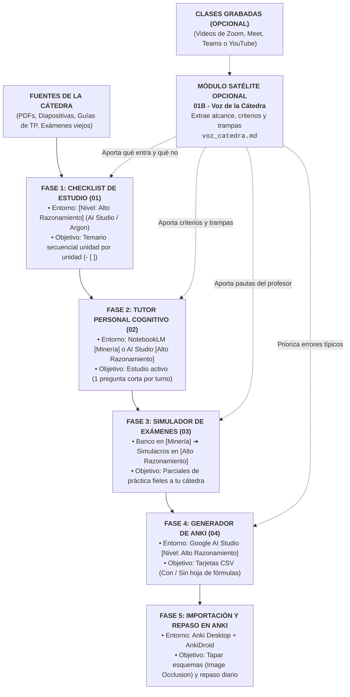

---
{"dg-publish":true,"permalink":"/20-areas/sistema-de-estudio-con-ia/00-inicio-y-flujo-de-trabajo/","title":"Sistema de Estudio con IA • Duilio Torres","tags":["guia","estudio-activo","workflow","ingenieria","gardenEntry"],"dg-note-properties":{"title":"Sistema de Estudio con IA • Duilio Torres","tags":["guia","estudio-activo","workflow","ingenieria","gardenEntry"]}}
---

> 👨‍💻 **Desarrollado por Duilio** • Sistema de Estudio Universitario con IA (Pensado para Ingeniería Mecánica, adaptable a cualquier carrera)

---

# 🚀 Sistema de Estudio Activo con IA: Flujo Completo

Este sistema no busca que la IA te haga resúmenes pasivos ni te resuelva las guías mientras mirás la pantalla. Su objetivo es usar la Inteligencia Artificial para aplicar la **ciencia del aprendizaje** (recuperación activa, práctica deliberada y repetición espaciada) preparando materias universitarias exigentes en menos tiempo y con el nivel real que toman en los exámenes de tu cátedra.

### ¿Cómo funciona si empezás desde cero?

En lugar de usar un chat genérico, dividimos el estudio de cada unidad en **5 fases conectadas**:
1. **Armás tu hoja de ruta (`Fase 1`):** La IA lee los apuntes y guías de la unidad y te arma una lista de control (*checklist*) con todo lo que tenés que saber explicar, deducir o calcular.
2. **Estudiás pensando (`Fase 2`):** Cargás un ítem de esa lista en el **Tutor Cognitivo**. No te da sermones largos: te hace **una sola pregunta corta por turno**, espera tu respuesta, corrige tus errores y te guía con pistas hasta que dominás el tema.
3. **Practicás como en el parcial (`Fase 3`):** El **Simulador de Exámenes** analiza los parciales viejos de tus profesores y te genera simulacros nuevos con la misma dificultad y estilo.
4. **Fijás en la memoria a largo plazo (`Fases 4 y 5`):** Convertís las fórmulas, condiciones de validez y esquemas clave en tarjetas de **Anki** para repasarlos en pocos minutos desde el celular.

> [!TIP] 📝 ¿Preferís estudiar en papel o que una IA te arme un plan personalizado con un saludo?
> Si no querés usar Anki ni configurar los 5 módulos, en **[[20. Áreas/Sistema de Estudio con IA/08 - Sistema de Estudio Tradicional (En Papel o con IA Simple)\|08 - Sistema de Estudio Tradicional (En Papel o con IA Simple)]]** tenés el **Arquitecto de Estrategia y Sistema de Estudio v3.5 (Beta)** (le subís tus apuntes y un saludo y te arma un plan a medida para cualquier materia) y el **flujo completo de estudio en papel de 4 fases + Modo Emergencia**.

> [!NOTE] 📌 Sobre la autoría y el uso responsable de IA
> Este sistema y su documentación fueron estructurados y redactados en gran parte con asistencia de inteligencia artificial, **a partir de mis propias ideas, metodología de estudio y experiencia directa en materias de ingeniería**.
>
> Todo el contenido, los prompts y los flujos de trabajo fueron **rigurosamente chequeados y probados en cursadas reales**. Sin embargo, ninguna IA es infalible: contrastá siempre cada resultado con los apuntes oficiales de tu cátedra. En el examen vas a estar solo.

---

## ⚡ Índice de Acceso Rápido

| Herramienta / Módulo                                | Entorno Recomendado                                             | ¿Para qué sirve?                                                                             | Enlace directo                                               |
| :-------------------------------------------------- | :-------------------------------------------------------------- | :------------------------------------------------------------------------------------------- | :----------------------------------------------------------- |
| **Fase 1: Extractor de Checklists**                 | `AI Studio (Gratis)` o `Argon` `[Alto Razonamiento]`            | Extrae el temario completo de la cursada unidad por unidad sin spoilers.                     | ➡️ **[[20. Áreas/Sistema de Estudio con IA/01 - Extractor de Checklists\|01 - Extractor de Checklists]]**                      |
| **Módulo Satélite: Voz de la Cátedra** *(Opcional)* | `NotebookLM` `[Minería]` ➔ `AI Studio` `[Alto Razonamiento]`    | Audita clases grabadas (videos/audios) y extrae qué entra, trampas y criterios del profesor. | ➡️ **[[20. Áreas/Sistema de Estudio con IA/01B - Extractor de Clases y Voz de la Cátedra\|01B - Extractor de Clases y Voz de la Cátedra]]**     |
| **Fase 2: Tutor Personal Cognitivo**                | `NotebookLM` `[Minería]` o `AI Studio` `[Alto Razonamiento]`    | Estudio socrático paso a paso (1 consigna corta por turno) sin regalar soluciones.           | ➡️ **[[20. Áreas/Sistema de Estudio con IA/02 - Tutor Personal Cognitivo\|02 - Tutor Personal Cognitivo]]**                     |
| **Fase 3: Simulador de Exámenes**                   | `NotebookLM` (Banco) + `AI Studio / Claude / Argon` (Generador) | Analiza parciales viejos de tu cátedra y genera simulacros reales con clave de corrección.   | ➡️ **[[20. Áreas/Sistema de Estudio con IA/03 - Simulador y Generador de Exámenes de Cátedra\|03 - Simulador y Generador de Exámenes de Cátedra]]** |
| **Fase 4: Generador de Anki**                       | `Google AI Studio` `[Alto Razonamiento]`                        | Crea mazos de tarjetas listas para importar (para exámenes con o sin hoja de fórmulas).      | ➡️ **[[20. Áreas/Sistema de Estudio con IA/04 - Generador de Tarjetas de Anki\|04 - Generador de Tarjetas de Anki]]**                |
| **Infraestructura de Modelos**                      | *Guía técnica*                                                  | Qué IA gratuita o paga elegir para cada tarea y cómo cuidar las cuotas de uso.               | ➡️ **[[20. Áreas/Sistema de Estudio con IA/05 - Modelos Recomendados por Tarea\|05 - Modelos Recomendados por Tarea]]**               |
| **Biblioteca de Aprendizaje**                       | *Fundamentos*                                                   | Los 7 libros científicos que explican por qué este método funciona.                          | ➡️ **[[20. Áreas/Sistema de Estudio con IA/06 - Biblioteca de Ciencia del Aprendizaje\|06 - Biblioteca de Ciencia del Aprendizaje]]**        |
| **Checklists de Autoevaluación**                    | *Diagnóstico*                                                   | 4 guías rápidas para auditar tus hábitos de estudio (o de docencia) antes del parcial.       | ➡️ **[[20. Áreas/Sistema de Estudio con IA/07 - Índice de Guías y Checklists de Aprendizaje\|07 - Índice de Guías y Checklists de Aprendizaje]]**  |
| **Sistema Tradicional + Arquitecto (Beta)** | *Papel + IA simple / Arquitecto v3.5* | Prompt del Arquitecto v3.5 (plan de estudio a medida con tus apuntes) + flujo en papel de 4 fases y Modo Emergencia. | ➡️ **[[20. Áreas/Sistema de Estudio con IA/08 - Sistema de Estudio Tradicional (En Papel o con IA Simple)\|08 - Sistema de Estudio Tradicional (En Papel o con IA Simple)]]** |
| **Historial de Versiones**                          | *Changelog*                                                     | Registro técnico de mejoras, pruebas y evolución de los prompts.                             | ➡️ **[[20. Áreas/Sistema de Estudio con IA/99 - Historial de Versiones (Changelog)\|99 - Historial de Versiones (Changelog)]]**           |

---

> [!WARNING] ⚠️ Reglas de Oro sobre las IAs que usamos (Actualizado 15/10/2026)
> Para no frustrarte con errores de la IA, tené presentes estas 3 reglas prácticas (explicadas a fondo en **[[20. Áreas/Sistema de Estudio con IA/05 - Modelos Recomendados por Tarea\|05 - Modelos Recomendados por Tarea]]**):
> 1. **NotebookLM es tu biblioteca central, pero se quedó atrás en razonamiento:** Su gran ventaja es que te deja subir de una sola vez los 40 archivos de la materia (apuntes, libros, TPs, parciales y videos) con **citas clickeables** y una **cuota diaria sumamente amplia** (ya no es infinita, pero es casi imposible agotarla estudiando). Sin embargo, frente a modelos modernos de **`[Nivel: Alto Razonamiento]`**, hoy resume de más, saltea temas sin avisar (*omisión silenciosa*) y falla al inventar problemas matemáticos.
> 2. **Google AI Studio (100% Gratuito) es tu motor de precisión:** Para extraer checklists, generar exámenes o crear tarjetas de Anki, usamos **Gemini 3.8 Flash** configurado en `Thinking level: High` dentro de Google AI Studio (o **Gemini Argon** si tenés plan pago), subiendo a mano los PDFs de la unidad que vas a trabajar.
> 3. **PROHIBIDO usar el conector de cuadernos dentro de Gemini Web (`gemini.google.com`):** La barra lateral de Gemini Web que conecta con NotebookLM tiene un bug grave e ignora la mayoría de los archivos del cuaderno. Cuando uses modelos de **`[Nivel: Alto Razonamiento]`**, subí siempre los PDFs directamente desde tu computadora.

---

## 🗺️ Mapa Global del Flujo (5 Fases + Módulo Opcional)

---

## Fase 1: Carga de Fuentes y Checklist de la Materia

El objetivo de este primer paso es armar el **mapa completo de cada unidad** en casillas de verificación (`- [ ]`), sin que la IA omita temas ni te revele las respuestas antes de estudiar.

### 1.1. Armá tu biblioteca general en NotebookLM

1. Creá un cuaderno gratuito en **[NotebookLM](https://notebook.google.com/)** con el nombre de la materia (ej: *Termodinámica Técnica*).
2. Subí **todo el material de la cursada**: programa, diapositivas, apuntes teóricos, guías de TP y parciales/finales de años anteriores. Este cuaderno será tu repositorio central para el resto del cuatrimestre.

### 1.2. Extraé la Checklist unidad por unidad (En Google AI Studio)

Para que la IA no resuma de más ni se saltee ejercicios, la lista de temas se extrae **de a una unidad por turno** en un motor de **`[Nivel: Alto Razonamiento]`**:
1. Abrí **[Google AI Studio](https://aistudio.google.com/)** con el modelo **Gemini 3.8 Flash** (activando `Thinking level: High` y `Media resolution: High` en el panel derecho) o **Gemini Argon**.
2. Subí desde tu PC los archivos PDF del **Programa** y de la **Unidad 1** (teoría, guía de TP y exámenes).
3. Pegá el prompt de **[[20. Áreas/Sistema de Estudio con IA/01 - Extractor de Checklists\|01 - Extractor de Checklists]]**. La IA va a generar las casillas `- [ ]` de la Unidad 1 ordenadas por conceptos, deducciones, gráficos y tipos de problemas `(TP X: Ej. N, M)`, y se detendrá automáticamente.
4. Copiá el bloque a tu nota de Obsidian, subí los PDFs de la Unidad 2 y escribí **`Seguí`** para recibir la siguiente unidad con el mismo nivel de detalle.

> [!NOTE] 📸 Captura de referencia: Extracción curricular
> 

---

## 🎙️ Módulo Satélite Opcional: Extractor de Clases y «Voz de la Cátedra»

> [!IMPORTANT] 📌 100% Opcional
> Este módulo aplica **únicamente si tu cátedra graba las clases** (Zoom, Meet, Teams o YouTube) y tenés los videos o audios. Si no tenés clases grabadas, pasá directo a la **Fase 2**.

Si tenés las grabaciones, los prompts de **[[20. Áreas/Sistema de Estudio con IA/01B - Extractor de Clases y Voz de la Cátedra\|01B - Extractor de Clases y Voz de la Cátedra]]** escanean lo que dice el profesor en clase y arman un documento compacto (`voz_catedra.md`) con citas exactas sobre:
- Qué temas entran y cuáles **no entran** en el parcial.
- Qué fórmulas hay que saber demostrar y cuáles solo aplicar.
- Qué errores típicos advierte en el pizarrón y qué unidades o diagramas exige al corregir.

Ese archivo `voz_catedra.md` se suma luego al Tutor, al Simulador de Exámenes y a Anki para estudiar enfocado en lo que realmente evalúa tu docente.

---

## Fase 2: Estudio Activo con el Tutor Cognitivo

Acá es donde aprendés los temas desde cero o resolvés las guías de TP. Podés ver todas las opciones y prompts en **[[20. Áreas/Sistema de Estudio con IA/02 - Tutor Personal Cognitivo\|02 - Tutor Personal Cognitivo]]**.

### 2.1. Dos formas de usar el Tutor

- **Ruta Estable en NotebookLM (`[Nivel: Minería y Recuperación]`):** Es la más cómoda para estudiar todos los días porque ya tenés todos los archivos cargados en un solo lugar, tenés **citas clickeables** que te abren la diapositiva exacta y una cuota amplísima para charlar durante horas. Podés usar el prompt compacto (<10.000 caracteres) o el **Prompt Extendido de 27.000 caracteres** mediante el truco de configuración que vemos abajo.
- **Ruta BETA en Google AI Studio (`[Nivel: Alto Razonamiento]`):** Ideal para días de cálculo pesado o deducciones complejas donde necesitás que la IA no falle en física ni en matemática. Solo requiere subir a mano los 2 o 3 PDFs del tema que vas a estudiar hoy.

### 2.2. Cómo cargar el Prompt Extendido (27k caracteres) en NotebookLM

El cuadro de configuración de NotebookLM corta los textos a los 10.000 caracteres. Para guardar el **Prompt Completo de 27.000 caracteres**, usamos la interfaz de Gemini Web únicamente como puente de guardado (para estudiar seguís usando la web de NotebookLM):

1. **Abrir el cuaderno desde Gemini:** Entrá a **[gemini.google.com](https://gemini.google.com)** y hacé clic en tu cuaderno en la barra lateral izquierda.

   > [!NOTE] 📸 Acceso al Notebook desde Gemini
   > 

2. **Entrar a Notebook Settings:** Hacé clic en los tres puntos (`...`) arriba a la derecha.

   > [!NOTE] 📸 Menú de opciones del cuaderno
   > 

3. **Pegar el prompt y guardar:** Pegá el prompt de 27k caracteres en **Instructions** y presioná **Save**.

   > [!NOTE] 📸 Guardado de directivas sin límite
   > 

4. **Verificar en NotebookLM:** Volvé a **[notebook.google.com](https://notebook.google.com/)**. En *Configure Chat* vas a ver **`27236 / 10000`** en violeta.

   > [!WARNING] ⚠️ Cerrá esa ventana con la cruz (`X`)
   > No edites ni toques nada adentro de esa ventana en NotebookLM para que el navegador no recorte el texto. El prompt de 27k ya quedó activo.
   > 

### 2.3. Cómo es una sesión de estudio

1. **Arranque:** Le pegás una casilla de tu checklist (`- [ ]`), le indicás la profundidad (`Baja`, `Media` o `Alta`) y si en el examen te dejan usar hoja de fórmulas.
2. **Una pregunta por turno:** La IA nunca te tira un resumen largo. Te hace una pregunta corta o te pide plantear el primer paso del problema. Si te trabás, te da pistas graduales o te muestra un ejemplo parecido con otros números para no arruinarte tu ejercicio.
3. **Cierre y continuidad (`HANDOFF`):** Cuando terminás el tema, te pide explicarlo de punta a punta con tus palabras. Al escribir `Cerrar unidad`, te entrega un bloque resumen (`HANDOFF`) para guardar en Obsidian y pegarlo en tu próxima sesión de estudio.

> [!NOTE] 📸 Captura de referencia: Sesión de tutoría activa
> 

---

## Fase 3: Simulador y Generador de Exámenes de Cátedra

Cuando ya estudiaste las unidades, esta fase analiza los exámenes viejos de tu materia para tomarte simulacros idénticos a los reales. Todos los prompts están en **[[20. Áreas/Sistema de Estudio con IA/03 - Simulador y Generador de Exámenes de Cátedra\|03 - Simulador y Generador de Exámenes de Cátedra]]**.

### 3.1. Extracción del ADN del examen (Pasos 1 a 3)

1. **`mapa.md` (Paso 1 en `AI Studio` - `[Alto Razonamiento]`):** Subís los apuntes de la unidad y los parciales viejos. La IA lista todas las habilidades evaluables y calcula cuántas veces se tomó cada una en la historia de la cátedra.
2. **`banco.md` (Paso 2 en `NotebookLM` - `[Minería]`):** Como en NotebookLM ya tenés todos los exámenes cargados, lo usás para transcribir el 100% de los parciales viejos y sumar solo 1 o 2 ejercicios clave de las guías de TP que cubran temas nunca tomados.
3. **`modelo.md` (Paso 3 en `AI Studio` - `[Alto Razonamiento]`):** Le pegás el mapa y el banco, y la IA resume en 70 líneas el estilo exacto de tu profesor (cuánto vale la teoría vs. la práctica, cómo redacta los incisos y qué errores descuentan puntos). *(Si casi no tenés parciales viejos con teoría, existe un Paso 3B opcional para cubrir preguntas teóricas).*

### 3.2. Generación de Simulacros (Paso 4 en `[Alto Razonamiento]`)

Con esos tres archivos `.md`, abrís un chat en **Google AI Studio (Gemini 3.8 Flash High)**, **Claude Sonnet 5.5** o **Gemini Argon** *(nunca uses NotebookLM acá porque falla en las cuentas)* y elegís cómo practicar:
- **Ruta A (Rendir a ciegas con corrección):** Pedís un `Examen`, lo resolvés en papel con cronómetro y usás el comando `Corregir`. La IA revisa tus cuentas paso a paso y, si te equivocaste en el inciso `a)` pero hiciste bien el planteo del `b)`, te considera el procedimiento por *arrastre* como hace un profesor real.
- **Ruta B (Paquetes listos para imprimir o compartir):** Usás el comando `Paquete` y la IA te genera en un solo mensaje el **Enunciado limpio + Resolución paso a paso en LaTeX + Trazabilidad**, listo para exportar a PDF y pasarle a tus compañeros.

---

## Fase 4: Generación de Tarjetas de Anki

Para no olvidarte las fórmulas, unidades o conceptos de las primeras unidades cuando llegás al parcial, creamos tarjetas de repaso espaciado con **[[20. Áreas/Sistema de Estudio con IA/04 - Generador de Tarjetas de Anki\|04 - Generador de Tarjetas de Anki]]**.

### 4.1. Configuración única en Google AI Studio

Usamos **[Google AI Studio](https://aistudio.google.com/prompts/new_chat)** porque es gratuito, permite guardar el prompt fijo y lee gráficos o subíndices chicos con máxima nitidez:

1. **Desactivar chat temporal:** Desmarcá *Temporary chat* para que tus chats queden guardados en Google Drive.

   > [!NOTE] 📸 Desactivar chat temporal
   > 

2. **Elegir el modelo:** Seleccioná `Gemini 3.8 Flash` en la columna derecha.

   > [!NOTE] 📸 Selección del modelo y acceso a System Instructions
   > 

3. **Guardar el prompt fijo en System Instructions:** Creá una instrucción con el prompt **CON hoja de fórmulas** (que no te pide memorizar ecuaciones largas, sino entender cómo varían) o **SIN hoja de fórmulas** (que te entrena para escribir las ecuaciones de memoria).

   > [!NOTE] 📸 Creación y guardado de instrucciones del sistema
   >   
   > 

4. **Poner Thinking y Media Resolution en High:** Así la IA analiza bien el apunte y lee con nitidez los diagramas de las diapositivas.

   > [!NOTE] 📸 Calibración en High (Thinking y Media Resolution)
   > 

### 4.2. Envío de apuntes por lotes cortos

Enviá de a **4 a 6 diapositivas** (o **1 a 2 páginas de apunte**) por mensaje, sumando si querés comentarios que haya dicho el profesor en clase. La IA te devolverá un bloque de código CSV listo para copiar.

> [!NOTE] 📸 Captura de referencia: Generación de mazos en bloque CSV
> 

---

## Fase 5: Importación, Image Occlusion y Repaso en Anki

> [!TIP] Prerrequisito
> Instalá **Anki** en tu computadora (gratuito en [apps.ankiweb.net](https://apps.ankiweb.net/)) y la app en tu celular (**AnkiDroid** en Android o **AnkiMobile** en iOS) vinculadas con la misma cuenta gratuita de AnkiWeb.

### 5.1. Guardar e importar el archivo CSV

1. Copiá el bloque CSV que te dio la IA, pegalo en el Bloc de notas y guardalo como `.csv` o `.txt` (ej: `unidad_1.csv`).
2. En Anki de PC, andá a **File ➔ Import...** y elegí el archivo.
3. Verificá estas opciones:
   * **Field separator:** `Semicolon` (Punto y coma).
   * **Allow HTML in fields:** **ACTIVADO** (en azul).
   * **Note Type:** `Basic`.
   * **Deck:** El mazo de tu materia.

> [!NOTE] 📸 Captura de referencia: Configuración de archivo y opciones
> 

4. En **Field mapping**, dejá `Front` en la columna 1, `Back` en la columna 2, `Tags` en `(Nothing)` y hacé clic en **Import**.

> [!NOTE] 📸 Captura de referencia: Mapeo de campos (Field mapping)
> 

---

### 5.2. Pasar esquemas y dibujos a Image Occlusion

Cuando el apunte tiene un corte de un equipo o un ciclo con partes para identificar, la IA crea tarjetas que empiezan con `[CREAR IMAGE OCCLUSION]`. Para agregarles la imagen y tapar sus nombres:

1. Abrí el explorador de Anki (**Browse** o tecla `B`), buscá `[CREAR IMAGE OCCLUSION]` y seleccioná todas (`Ctrl + A`).
2. Hacé clic derecho ➔ **Notes ➔ Change Note Type...** y cambiá de `Basic` a `Image Occlusion`.
3. Mapeá los campos así y guardá (**Save**):
   * `Front` ➔ **Header**
   * `Back` ➔ **Back Extra** *(acá te queda anotado qué partes tenés que tapar y qué función cumple cada una)*.
   * El resto dejalo en `(Nothing)`.

> [!NOTE] 📸 Captura de referencia: Mapeo para cambio de tipo de nota
> 

4. Confirmá el aviso haciendo clic en **Yes**.

> [!NOTE] 📸 Captura de referencia: Confirmación de subida completa
> 

---

### 5.3. Sincronización segura entre PC y Celular

> [!DANGER] ⛔ Cuidado al sincronizar después de cambiar el tipo de nota
> Cuando convertís tarjetas a *Image Occlusion*, Anki te pregunta qué base de datos querés conservar. Si tocás el botón equivocado, borrás lo que acabás de importar.

1. **Primero en tu PC (Anki Desktop):** Presioná **Sync** y elegí siempre **`Upload to AnkiWeb`** (Subir a AnkiWeb).

   > [!NOTE] 📸 Captura de referencia: Selección de Upload to AnkiWeb en PC
   > 

2. **Después en tu celular (AnkiDroid):** Presioná sincronizar y elegí **`AnkiWeb`** (para descargar a tu teléfono lo que subiste desde la PC).

   > [!NOTE] 📸 Captura de referencia: Selección de AnkiWeb en AnkiDroid
   > 

---

### 5.4. Pegar la imagen y tapar las partes

En el explorador (`B`) de tu PC, hacé clic en cada tarjeta de `[CREAR IMAGE OCCLUSION]`:

> [!NOTE] 📸 Captura de referencia: Botones de control del editor de oclusión
> 

1. **Botón 1 (Texto):** Borrá el cartel `[CREAR IMAGE OCCLUSION]` del título para que quede limpio, y mirá en **Back Extra** qué partes te indica tapar la IA.
2. **Botón 2 (Resetear imagen):** Tocá el segundo ícono para limpiar el lienzo en blanco.
3. **Pegar captura y tapar:** Sacale una captura a la figura de tu apunte (`Win + Shift + S`), pegala con `Ctrl + V` y dibujá rectángulos sobre los nombres a ocultar. *(Tip: si al pegar la imagen no te deja dibujar rectángulos, tocá dos veces el Botón 1 para refrescar la ventana).*

---

## 🛠️ Guías Complementarias del Sistema

Además de las herramientas paso a paso, tenés tres secciones de consulta para mejorar tu forma de estudiar:

- 🤖 **[[20. Áreas/Sistema de Estudio con IA/05 - Modelos Recomendados por Tarea\|05 - Modelos Recomendados por Tarea]]**: Guía actualizada sobre qué modelo de IA elegir en cada paso y cómo cuidar tus límites de uso gratuitos o pagos.
- 📚 **[[20. Áreas/Sistema de Estudio con IA/06 - Biblioteca de Ciencia del Aprendizaje\|06 - Biblioteca de Ciencia del Aprendizaje]]**: Resumen de los 7 libros científicos (encabezados por *A Mind for Numbers* de Barbara Oakley) que explican cómo funciona la memoria y la resolución de problemas en ingeniería.
- 🧭 **[[20. Áreas/Sistema de Estudio con IA/07 - Índice de Guías y Checklists de Aprendizaje\|07 - Índice de Guías y Checklists de Aprendizaje]]**: 4 checklists de autoevaluación para revisar tus hábitos de estudio unas semanas antes del parcial y evitar la *ilusión de competencia* (sentir que sabés el tema solo porque entendés el apunte al leerlo).
- 📝 **[[20. Áreas/Sistema de Estudio con IA/08 - Sistema de Estudio Tradicional (En Papel o con IA Simple)\|08 - Sistema de Estudio Tradicional (En Papel o con IA Simple)]]**: El "espejo analógico" del sistema para estudiar ingeniería en papel o usando un chat de IA común sin configuraciones técnicas.
- 📜 **[[20. Áreas/Sistema de Estudio con IA/99 - Historial de Versiones (Changelog)\|99 - Historial de Versiones (Changelog)]]**: Registro técnico de todas las actualizaciones y mejoras de los prompts.

---

## 🤝 Propósito del Proyecto y Contacto

Armé este sistema durante mis cursadas de Ingeniería Mecánica con una sola idea: **ayudar de forma 100% gratuita a cualquier estudiante universitario a estudiar mejor**, usando la IA para pensar más y no para pensar menos.

- **Libre y abierto:** Compartilo con tus compañeros, usalo en grupos de estudio o adaptá los prompts a tu propia carrera (sea otra ingeniería, ciencias exactas, medicina o derecho).
- **Contacto y sugerencias:** No uso redes sociales, pero si tenés alguna duda implementando el flujo, encontraste algún error o querés sugerir una mejora, escribime a **[duiliobtorres@gmail.com](mailto:duiliobtorres@gmail.com)**. ¡Muchos éxitos!