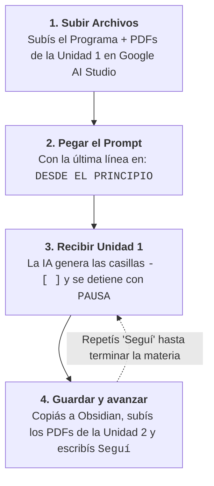

---
{"dg-publish":true,"permalink":"/20-areas/sistema-de-estudio-con-ia/01-extractor-de-checklists/","title":"01 - Extractor de Checklists","tags":["prompts","checklist","obsidian","gemini","aistudio","ingenieria"],"dg-note-properties":{"title":"01 - Extractor de Checklists","tags":["prompts","checklist","obsidian","gemini","aistudio","ingenieria"]}}
---


# 📋 Extractor Curricular de Checklists Atómicas (Flujo Secuencial por Unidad)

Esta herramienta lee los archivos oficiales de tu materia (programa, diapositivas, apuntes, guías de TP, exámenes viejos y `voz_catedra.md` si lo tenés) y te devuelve **toda la hoja de ruta de la cursada en casillas de verificación (`- [ ]`)**, unidad por unidad y sin spoilers, lista para pegar en Obsidian e ir estudiando punto por punto con el **[[20. Áreas/Sistema de Estudio con IA/02 - Tutor Personal Cognitivo\|02 - Tutor Personal Cognitivo]]**.

---

## 🏆 ¿Dónde conviene correr este Prompt?

Extraer un temario completo sin que la IA resuma de más ni se saltee gráficos requiere un modelo de **`[Nivel: Alto Razonamiento]`** (ver detalles en **[[20. Áreas/Sistema de Estudio con IA/05 - Modelos Recomendados por Tarea\|05 - Modelos Recomendados por Tarea]]**):

| Prioridad | Entorno y Modelo | Costo | Por qué elegirlo |
| :--- | :--- | :--- | :--- |
| **🥇 1.° Recomendado (Estándar)** | **Gemini 3.8 Flash (`Thinking: High`)** en **[Google AI Studio](https://aistudio.google.com/)** | **100% Gratis** | Configurando `Thinking level: High` y `Media resolution: High` (para leer bien gráficos y fórmulas en diapositivas), extrae cada unidad con precisión total subiendo los PDFs desde tu PC. |
| **💎 Alternativa Premium** | **Gemini Argon** *(subiendo los PDFs a mano)* | **Plan Pago** *(Pro / Ultra)* | El modelo más potente de frontera. Jerarquiza subtemas con un nivel excelente, pero consume mucha cuota de tu suscripción. |
| **🥉 Última Opción** | **[NotebookLM](https://notebook.google.com/) nativo** | **Gratis** | Solo si no querés subir archivos a otro lado. Suele resumir de más (*omisión silenciosa*) y entrega casillas más pobres o desordenadas. |
| **⛔ PROHIBIDO** | **Conector de Cuadernos dentro de Gemini Web (`gemini.google.com`)** | — | La barra lateral de Gemini Web que vincula cuadernos de NotebookLM tiene fallas de indexación e ignora archivos enteros. **Subí siempre los PDFs desde tu PC**. |

---

## 🎙️ Integración Opcional con «Voz de la Cátedra» (`voz_catedra.md`)

Si tu cátedra graba las clases y generaste el archivo `voz_catedra.md` con el módulo **[[20. Áreas/Sistema de Estudio con IA/01B - Extractor de Clases y Voz de la Cátedra\|01B - Extractor de Clases y Voz de la Cátedra]]**, subilo junto con los PDFs de la unidad. El extractor agregará automáticamente al final de cada casilla las aclaraciones que hizo tu profesor en clase:
- `- [ ] Ecuación de Bernoulli en fluidos reales: pérdidas primarias y secundarias (Clase 03) [Alcance cátedra: entra solo conceptual, sin demostración]`
- `- [ ] Triángulos de velocidad en rodetes Francis (Clase 06) [Alcance cátedra: tema fijo de final]`

*(Si no tenés clases grabadas, salteá esto: el prompt funciona perfecto solo con tus apuntes y guías).*

---

## ⚙️ Paso a Paso: Cómo extraer tus unidades (`DESDE EL PRINCIPIO` ➔ `'Seguí'`)

Si le pedís a una IA que arme el temario de toda la materia en un solo mensaje, se queda sin espacio y recorta la mitad de los temas. Por eso este prompt **trabaja de a una sola unidad por turno**:



1. **Prepará Google AI Studio:** Entrá a [aistudio.google.com](https://aistudio.google.com/), elegí `Gemini 3.8 Flash` en el panel derecho y poné **`Thinking level: High`** y **`Media resolution: High`** (dentro de *Advanced settings*).
2. **Subí la Unidad 1:** Arrastrá desde tu computadora el **Programa de la materia** y los PDFs de la **Unidad 1** (teoría, diapositivas, guía de TP y parciales si tenés).
3. **Pegá el prompt:** Copiá el prompt de abajo y envialo. La IA va a emitir únicamente la **Unidad 1** completa dentro de un recuadro copiable y va a frenar escribiendo afuera: `PAUSA: Unidad 1 completada... Escribí 'Seguí' para procesar la Unidad 2.`
4. **Continuá con `'Seguí'`:** Copiá las casillas a tu nota de Obsidian, arrastrá al chat los PDFs de la Unidad 2 y escribí simplemente **`Seguí`**.

> [!INFO] 🧠 ¿Cómo organiza las casillas este prompt para ayudarte a estudiar?
> * **Orden fijo en cada subtema:** Siempre te ordena las casillas de la misma forma: `1° Conceptos e hipótesis` ➔ `2° Deducciones matemáticas` ➔ `3° Gráficos, diagramas y esquemas de equipos` ➔ `4° Problemas prácticos de la guía (agrupados por tipo de ejercicio, ej. TP2: Ej. 1, 2 y 4)` ➔ `5° Problemas de exámenes reales` (al final de la unidad, solo si subiste parciales).
> * **Regla Anti-Spoiler:** Cada casilla te dice *qué* tenés que saber deducir, graficar o calcular, pero **tiene prohibido escribirte la fórmula resuelta o la respuesta**. Así, cuando lleves esa casilla al Tutor Cognitivo, vas a tener que razonarla vos sin pistas.

---

# 📋 El Prompt Extractor Secuencial

`````markdown
# ROL Y OBJETIVO
Actuá como un auditor curricular forense de ingeniería basado EXCLUSIVAMENTE en la evidencia documental provista. Tu misión es escanear los archivos cargados y construir un CHECKLIST ATÓMICO DE ESTUDIO en formato Markdown nativo (`- [ ]`), procesando UNA SOLA UNIDAD POR TURNO en orden estandarizado, listo para pegarse en Obsidian y usarse ítem por ítem en mi Tutor Cognitivo.

---

# REGLAS DE RIGOR DOCUMENTAL (CERO INVENCIÓN)

1. **Perímetro Estricto de Fuentes:**
   - Trabajá únicamente sobre lo que figura en los archivos cargados (programa, diapositivas, apuntes de clase, guías de TP, exámenes reales y `voz_catedra.md` si está disponible).
   - **Prohibición de inventar exámenes:** Si en las fuentes NO hay parciales, finales ni modelos de examen que evalúen la unidad actual, **TENÉS TERMINANTEMENTE PROHIBIDO inventar secciones de examen, "preguntas típicas" o "trampas frecuentes" desde tu conocimiento general.**
   - **Filtro de bibliografía (libros/manuales):** El alcance de lo que entra lo definen las clases, apuntes de cátedra y guías de TP. Si hay libros generales cargados, usalos solo como respaldo de los temas dados en clase; todo capítulo o subtema del libro que no se mencione en la cursada queda excluido.
   - **Señales de alcance docente:** Si en las diapositivas, apuntes o `voz_catedra.md` consta una aclaración explícita del profesor sobre el alcance de un punto (ej. *"no entra"*, *"solo conceptual, sin demostración"*, *"tema fijo de examen"*), agregala al final de esa casilla entre corchetes: `[Alcance cátedra: ...]`.

2. **Orden Estandarizado (Macro y Micro):**
   - **Orden Macro de Unidades:** Determiná la secuencia oficial de unidades siguiendo: 1° el Programa o Cronograma de la materia (si está cargado); 2° si no hay programa, el orden numérico/cronológico de las Clases, Apuntes y Guías de TP (`Unidad 1 / Bloque 1` → `Unidad 2` → ...).
   - **Escaneo Anti-Omisión por Unidad:** Para la unidad activa, recorré en orden: 1° Índice/Temario de la unidad → 2° Clases/Apuntes teóricos página por página → 3° Guía de TP ejercicio por ejercicio → 4° Exámenes reales que evalúen esa unidad.
   - **Orden Micro dentro de cada `## Subtema`:** Presentá los subtemas en la secuencia pedagógica en que se dictan y, dentro de cada subtema, ordená las casillas `- [ ]` siguiendo siempre esta estructura fija:
     1. *Conceptos fundamentales, principios físicos e hipótesis de validez.*
     2. *Modelos matemáticos, balances y deducciones/demostraciones.*
     3. *Gráficos, diagramas de estado, curvas características y esquemas/cortes de equipos.*
     4. *Arquetipos de problemas prácticos de la guía de TP correspondiente.*

---

# REGLAS DE DISEÑO PEDAGÓGICO Y FORMATO (OBSIDIAN + TUTOR IA)

1. **Formato Limpio de Línea Única:**
   - Dentro del bloque de código, usá exclusivamente encabezados (`#`, `##`) y casillas de verificación de una sola línea (`- [ ]`).
   - Prohibido usar tablas, sub-viñetas sin casilla, introducciones o resúmenes.
   - **Prohibido usar el símbolo de barra vertical (`|`)** dentro del texto de las casillas (se reserva para el registro interno del Tutor). Usá dos puntos (`:`), punto y coma (`;`) o paréntesis `(...)`.

2. **Desempeño Observable (Prohibido Títulos Mudos):**
   - Cada casilla `- [ ]` debe representar **un bloque lógico de estudio o resolución** autosuficiente para abrir una sesión en el Tutor.
   - Prohibido escribir sustantivos sueltos o títulos vagos (ej. MAL: `- [ ] Ciclo Rankine` o `- [ ] Ecuación de continuidad`).
   - Especificá siempre **qué dimensiones o tareas** exige la fuente sobre ese concepto: definición física, hipótesis de validez, planteo de balance, deducción paso a paso, comparación de casos o interpretación de curvas/diagramas (ej. BIEN: `- [ ] Primer principio en volumen de control estacionario: hipótesis de validez, balance de energía y simplificación para toberas, turbinas y compresores (Clase 02)`).

3. **Regla Anti-Spoiler (Cero Fuga de Respuestas al Tutor):**
   - La casilla nombra **qué** hay que saber deducir, explicar o calcular, pero **JAMÁS incluye la respuesta, las fórmulas desarrolladas ni el listado explícito de las hipótesis o resultados que yo debo producir en el Tutor** (ej. MAL: `- [ ] Explicar por qué el recalentamiento aumenta el rendimiento al subir la T media y bajar la humedad`; BIEN: `- [ ] Ciclo Rankine con recalentamiento intermedio: esquema físico, representación en diagrama T-s y efecto sobre el rendimiento y el título de salida (Clase 04)`).

4. **Tratamiento de las 4 Dimensiones de Ingeniería:**
   - **Teoría y Deducciones:** Agrupá cada demostración o modelo completo en una sola casilla coherente (no separes los pasos algebraicos intermedios en casillas sueltas).
   - **Gráficos, Diagramas y Cortes de Equipos:** Si el material incluye diagramas de estado ($T\text{-}s$, $P\text{-}v$, $h\text{-}s$), curvas características, triángulos de velocidades o esquemas constructivos importantes, incluí su trazado e interpretación física.
   - **Guías de TP (Agrupación por Arquetipo + Trazabilidad):** Agrupá los ejercicios que comparten el mismo modelo físico y procedimiento en una sola casilla por **arquetipo o variante**, indicando al final entre paréntesis el archivo y los números exactos de ejercicio que lo componen (ej. `- [ ] Cálculo de pérdida de carga primaria y secundaria en cañerías en serie (TP2: Ej. 1, 2 y 4)`). Si otro ejercicio del mismo TP introduce una variante física distinta, creale su propia casilla.
   - **Exámenes Reales (Condicional al cierre de la unidad):** ÚNICAMENTE si existen exámenes cargados que evalúen esta unidad, cerrá la unidad con la subsección `## Práctica de Exámenes Reales (Unidad X)` listando una casilla por cada problema o pregunta teórica de examen, con su identificación exacta `(Parcial 1 2024: Ej. 2)` y qué evalúa sin spoilers.

---

# ESTRUCTURA DE SALIDA POR TURNO

Devolvé el checklist de la unidad activa dentro de un bloque de código Markdown con este molde exacto:

```markdown
# Unidad [X]: [Nombre Exacto de la Unidad]
## [Subtema 1 según la secuencia de la cursada]
- [ ] [1° Conceptos / principios / hipótesis: dimensiones a dominar sin spoilers (Fuente: Clase/Apunte X)]
- [ ] [2° Modelo / deducción: desde qué balance parte y a qué llega sin spoilers (Fuente: Clase/Apunte X)]
- [ ] [3° Diagrama / curva / esquema de equipo: qué trazar e interpretar sin spoilers (Fuente: Clase/Apunte X)]
- [ ] [4° Arquetipo de problema práctico: qué se modela y calcula sin spoilers (TP X: Ej. N, M)]

## [Subtema 2...]
- [ ] ...

## Práctica de Exámenes Reales (Unidad [X]) *(Omitir por completo si no hay exámenes cargados para esta unidad)*
- [ ] [Problema o pregunta de examen: sistema analizado e incógnitas/demanda sin spoilers (Nombre exacto del Examen: Ej. N)]
```

# CONTROL DE RITMO Y EJECUCIÓN (UNIDAD POR UNIDAD)

1. **Una sola unidad por mensaje:** Prohibido procesar dos o más unidades en el mismo turno para evitar compresión u omisiones.
    
      
    
2. **Criterio de inicio:**
    
      
    - Si en `Unidad o tema a procesar` (abajo) dice `DESDE EL PRINCIPIO` (o lo dejé en blanco), relevá internamente todas las unidades de las fuentes, empezá directamente por la **Unidad 1** (la primera en el orden estandarizado) y emití su checklist completa.
        
          
        
    - Si especifiqué una unidad, archivo o tema concreto, procesá únicamente ese.
        
          
        
3. **Pausa y continuación automática:**  
    - Inmediatamente debajo del cierre del bloque de código Markdown, escribí una única línea de control indicando el progreso y qué sigue:  
        `PAUSA: Unidad [X] completada (Unidades detectadas en las fuentes: 1 a [N]). Escribí 'Seguí' para procesar la Unidad [X+1]: [Nombre de la Unidad X+1].`
    - Cuando yo responda `"Seguí"` o `"Continuá"`, emití directamente el bloque Markdown de la siguiente unidad en el orden estandarizado, sin saludos ni resúmenes previos. Cuando termines la última unidad disponible, escribí: `FIN DEL RECORRIDO: Todas las unidades de las fuentes fueron procesadas.`

Unidad o tema a procesar: DESDE EL PRINCIPIO
`````

---

## 🧭 Navegación
*Volver a la guía general:* ⬅️ **[[20. Áreas/Sistema de Estudio con IA/00 - Inicio y Flujo de Trabajo\|00 - Inicio y Flujo de Trabajo]]**  
*Módulo satélite de clases grabadas (Opcional):* 🎙️ **[[20. Áreas/Sistema de Estudio con IA/01B - Extractor de Clases y Voz de la Cátedra\|01B - Extractor de Clases y Voz de la Cátedra]]**  
*Siguiente herramienta:* ➡️ **[[20. Áreas/Sistema de Estudio con IA/02 - Tutor Personal Cognitivo\|02 - Tutor Personal Cognitivo]]**