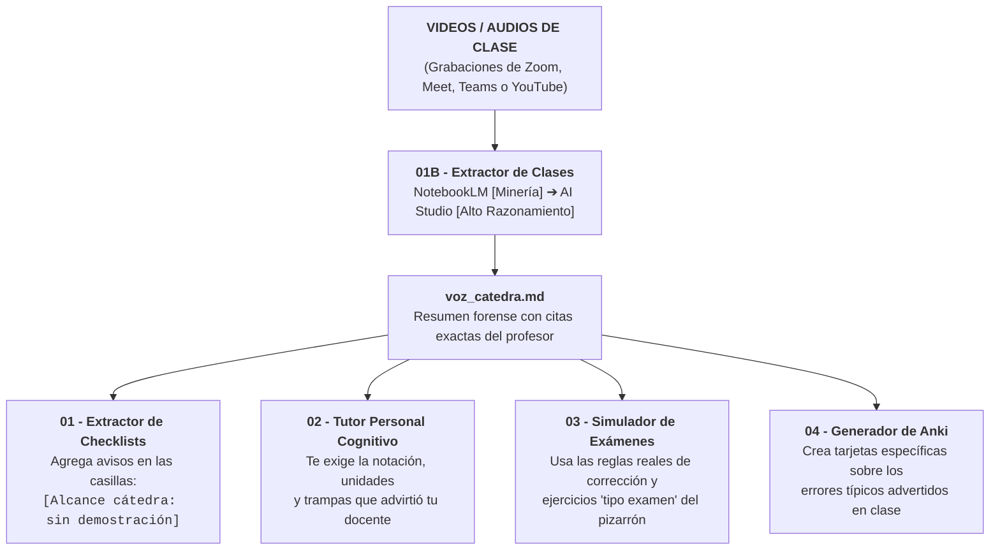
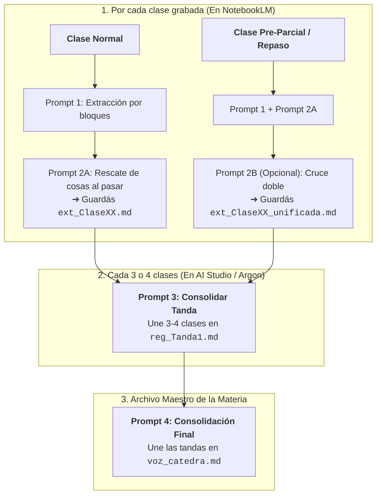

---
{"dg-publish":true,"permalink":"/20-areas/sistema-de-estudio-con-ia/01-b-extractor-de-clases-y-voz-de-la-catedra/","title":"01B - Extractor de Clases y Voz de la Cátedra","tags":["prompts","catedra","video","voz-catedra","notebooklm","gemini","aistudio","ingenieria"],"dg-note-properties":{"title":"01B - Extractor de Clases y Voz de la Cátedra","tags":["prompts","catedra","video","voz-catedra","notebooklm","gemini","aistudio","ingenieria"]}}
---


# 🎙️ Extractor de Clases y «Voz de la Cátedra» (Módulo Opcional)

> [!IMPORTANT] 📌 Módulo 100% Opcional
> Esta herramienta **NO es obligatoria** para usar el sistema de estudio. Sirve **únicamente si tu cátedra graba las clases** (en Zoom, Meet, Teams o YouTube) y tenés los videos, audios o transcripciones. Si tu cursada no tiene clases grabadas, pasá directamente a **[[20. Áreas/Sistema de Estudio con IA/01 - Extractor de Checklists\|01 - Extractor de Checklists]]**.

Cuando los profesores dan clase, suelen tirar información valiosísima que no está escrita en ningún PDF: aclaran qué demostración **no van a tomar**, avisan dónde se equivoca todo el mundo en el parcial, dicen qué unidades exigen sí o sí o resuelven un ejercicio diciendo *"este es tipo examen"*.

Este sistema escanea las grabaciones por vos y arma un único archivo ultracompacto con citas exactas llamado **`voz_catedra.md`**, sin que tengas que volver a escuchar videos de dos horas antes del parcial.

---

## 🧩 ¿Para qué sirve `voz_catedra.md` en las demás herramientas?

Una vez que obtenés tu archivo `voz_catedra.md`, podés subirlo junto con tus apuntes en cualquiera de las fases del sistema:



---

## 🏆 ¿Qué IA usar en cada etapa?

Combinamos dos entornos gratuitos según lo que hace mejor cada uno (ver detalles en **[[20. Áreas/Sistema de Estudio con IA/05 - Modelos Recomendados por Tarea\|05 - Modelos Recomendados por Tarea]]**):

| Etapa del proceso | Nivel Cognitivo | 🥇 Entorno Recomendado | Por qué se usa acá |
| :--- | :--- | :--- | :--- |
| **Pasos 1 y 2** *(Analizar cada video)* | `[Nivel: Minería y Recuperación]` | **NotebookLM Nativo** *(o AI Studio si tenés la transcripción en `.txt`)* | NotebookLM te deja pegar links directos de YouTube o subir archivos de audio/video pesados y te genera **citas clickeables** para verificar qué dijo el profesor. |
| **Pasos 3 y 4** *(Unir varias clases en un solo archivo)* | `[Nivel: Alto Razonamiento]` | **Gemini 3.8 Flash (`Thinking: High`) en AI Studio** *(o Gemini Argon en plan pago)* | Como en estos pasos ya solo unís tus propios textos `.md`, los modelos de alto razonamiento agrupan las ideas repetidas en un solo renglón sin perder ningún dato. |

---

## 🗺️ Cómo es el Flujo de Trabajo (Paso a Paso)

> [!TIP] 💡 Ruta normal sin complicarte
> Para cualquier clase común solo corrés el **Prompt 1** y enseguida el **Prompt 2A** en el mismo chat. Cuando juntás 3 o 4 clases de una unidad, las unís con el **Prompt 3**, y antes del parcial armás el archivo final con el **Prompt 4**. *(El Prompt 2B es opcional y solo se usa para la clase clave de repaso antes del examen).*



1. **Paso 1 — Extracción por video (`ext_ClaseXX.md`):** Seleccionás **una sola clase** en NotebookLM y pegás el Prompt 1. La IA divide la clase en bloques y te entrega de a 4 bloques por turno para no resumir nada. Vos escribís **`Seguí`** hasta que llega al final de la clase.
2. **Paso 2A — Rescate de puntos ciegos:** En ese mismo chat, pegás el Prompt 2A. La IA vuelve a revisar el principio, el final y los comentarios al pasar del profesor que se le hayan escapado. Copiás todo y lo guardás como `ext_ClaseXX.md`.
3. **Paso 2B — Verificación doble *(Opcional, solo para clases de repaso pre-parcial)*:** Si en una clase el profesor tiró todas las pautas del parcial, podés correr el Paso 1+2A dos veces en chats separados y cruzar ambos textos con el Prompt 2B para tener certeza de que no se perdió ni una palabra.
4. **Paso 3 — Unir una tanda de 3 o 4 clases (`reg_TandaN.md`):** Abrís un chat en Google AI Studio (`Gemini 3.8 Flash High`), pegás los textos `ext_Clase01.md` a `04.md` junto con el Prompt 3, y la IA agrupa todo lo repetido en renglones compactos (se entrega en 2 partes escribiendo `Seguí`).
5. **Paso 4 — Armar el documento final (`voz_catedra.md`):** Pegás tus archivos `reg_Tanda1.md`, `reg_Tanda2.md`, etc. con el Prompt 4 y en 3 entregas (`Seguí`) tenés listo el archivo maestro de la materia.

---

## 🏷️ ¿Qué significan las letras y etiquetas que genera el archivo?

Para que puedas buscar rápido antes del parcial y la IA nunca invente que algo "entra seguro" si el profesor solo dijo que era importante, cada cita queda clasificada por una letra (de mayor a menor prioridad) y su nivel de certeza:

- **`A. EXAMEN`**: Reglas confirmadas del parcial o final (qué entra, qué **no** entra, cantidad de ejercicios, puntajes, tablas permitidas y fechas).
- **`K. ALCANCE Y PROFUNDIDAD`**: Hasta dónde tenés que saber cada tema (`calcular`, `justificar`, `no demostrar`, `no memorizar la fórmula`).
- **`G. CRITERIOS DE RESOLUCIÓN`**: Qué te exigen escribir en la hoja para no descontarte puntos (declarar hipótesis, dibujar el volumen de control, unidades obligatorias).
- **`F. ERRORES Y TRAMPAS`**: Advertencias textuales del docente (*"cuidado con este signo"*, *"acá se confunden siempre en el parcial"*).
- **`B. ÉNFASIS`** y **`C. DESÉNFASIS`**: Temas que el profesor recalca varias veces (`B`) vs. temas que pasa por arriba o deja como lectura optativa (`C`).
- **`D. PREGUNTAS DEL PROFESOR`** y **`E. PREGUNTAS DE ALUMNOS`**: Preguntas que hace el docente en clase con tono de examen (`D`) o dudas de compañeros que destraban una explicación clave (`E`).
- **`H. EJERCICIOS EN CLASE`**, **`I. CORRECCIONES AL MATERIAL`** y **`J. OTROS`**: Problemas resueltos en pizarrón (`H`), fe de erratas de diapositivas/guías (`I`) y consejos de bibliografía (`J`).

**Niveles de certeza:**
* **`EXPLÍCITO`**: El profesor lo dijo de forma literal (*"Esto no entra en el parcial"*).
* **`SEÑAL DOCENTE` / `INFERENCIA`**: El profesor no habló del examen, pero repitió 3 veces la misma idea o volvió dos diapositivas atrás para recalcarla. *(El sistema prohíbe usar inferencias en la categoría `A` para nunca inventar reglas de examen).*

---

## 📋 Los Prompts del Sistema

### 1️⃣ Prompt 1: Extracción por Video

* **Dónde usarlo:** En NotebookLM (dejando marcada **una sola clase** en la barra de fuentes) o en Google AI Studio.
* **Cómo avanzar:** Escribí **`Seguí`** cada 4 bloques hasta llegar al *Cierre de la Clase*.

`````markdown
# ROL
Registrador forense de señales de cátedra. Trabajás sobre UNA clase (la única fuente seleccionada) en una herramienta que cita con marcadores clickeables. Tu producto es un REGISTRO AUDITABLE de lo que el profesor dice e indica sobre evaluación, énfasis, preguntas, errores y alcance, preservando la evidencia primaria (cita textual + marcador clickeable + bloque). NO explicás temas, NO resumís la clase, NO resolvés ejercicios, NO predecís el examen. Los contenidos ya los tengo en mis apuntes.

# REGLAS DE EJECUCIÓN Y ANTI-BUCLE
- Trabajá en una sola pasada lineal de principio a fin. No re-verifiques ni rehagas bloques ya escritos. Los conteos del cierre se hacen una sola vez; si un número no cuadra, anotalo en Dudas y no rehagas la salida.
- PROHIBIDO buscar, calcular, estimar o escribir minutos, relojes o duración del video. La herramienta no provee tiempos confiables: ubicá todo únicamente por número de bloque y con el marcador de cita clickeable de la herramienta.

# PRINCIPIOS ANTI-PÉRDIDA (prioridad máxima)
1. DETECCIÓN CONSERVADORA: ante duda razonable de si un fragmento contiene información sobre evaluación, prioridades, errores, expectativas, alcance o preguntas, CONSERVALO y marcalo [¿?]. Preferible falso positivo a omisión. Primero detectá, después clasificá; nunca descartes algo porque no encaje en A–I (usá J).
2. EXTRACCIÓN LOCAL: no construyas una interpretación global de la clase. Trabajá en secuencia estricta: bloque → evidencia → clasificación → siguiente bloque.
3. EXHAUSTIVIDAD SIN FUSIÓN: prohibido resumir, agrupar o fusionar. Una señal = una entrada, aunque se repita (cada repetición se registra en el punto exacto donde ocurre). Una misma evidencia puede llevar varias categorías (ej. [A/K]), pero NUNCA fusiones dos evidencias distintas en una sola entrada.
4. ORDEN ESTRICTO: recorré la fuente en orden sin saltear nada. Si un bloque no tiene señales, escribí `Bloque X: sin señales`.
5. CITA LITERAL: cita textual entre comillas, sin recortar lo sustantivo, seguida del marcador clickeable de la fuente. Prohibido parafrasear la cita.
6. DATO DESCONOCIDO = NO DETERMINABLE (tema al que apunta un "esto", quién habló, intención). Prohibido completar por contexto o conocimiento general.
7. DUDAS DE FUENTE: frase cortada, ambigua o mal transcripta → `[AMBIGUO]` o `[AUDIO DUDOSO]` + motivo breve.
8. ACCIONES VISUALES (escribe en pizarra, subraya, señala diapositiva): registralas SOLO si el profesor las verbaliza ("acá les recuadro...", "fíjense en esta curva") o son observables directamente en la fuente. Nunca las infieras.
9. CERO PREDICCIÓN: prohibido lenguaje predictivo ("seguro entra", "probablemente", "riesgo"). Solo registrás lo dicho o hecho.

# NIVEL DE LA SEÑAL (obligatorio en cada entrada; en D se usa su subtipo)
- EXPLÍCITO: declaración literal y directa ("esto entra", "esto no lo tomo", "esto es clave").
- SEÑAL DOCENTE: conducta observable en el discurso sin declaración directa (repite una idea en distintos momentos, vuelve atrás para recalcar, advierte un error, insiste en un método). Describí la conducta observable (y con qué entradas previas conecta si es repetición), no la conclusión. "Extensión del desarrollo" no es señal por sí sola.
- INFERENCIA: lectura acotada de una SEÑAL DOCENTE. Nunca genera una entrada separada: se escribe como extensión dentro de la misma entrada (`SEÑAL DOCENTE -> INFERENCIA`). No crea contenido, no atribuye intenciones no dichas y está PROHIBIDA en la categoría A.
  Correcto: `Conducta: vuelve sobre X por tercera vez (ver E02, E09) | Inferencia: énfasis por reiteración`.
  Incorrecto: `quiere que estudiemos X porque probablemente lo tome`.

# CATEGORÍAS
A. EXAMEN: qué entra y qué NO, formato, cantidad de ejercicios, teoría vs. práctica, puntaje, aprobación, material permitido, cómo corrige, qué descuenta, fechas, recuperatorios.
B. ÉNFASIS: lo que remarca ("clave", "no se olviden", "fundamental"), reiteraciones.
C. DESÉNFASIS: secundario, "lo ven por su cuenta", "no profundizamos", "es de otra materia", lo que pasa por alto.
D. PREGUNTAS DEL PROFESOR: todas, textuales. Subtipo obligatorio: `[EVALUATIVA-POTENCIAL]` (suena a consigna de examen) / `[CONCEPTUAL]` / `[COMPROBACIÓN]` / `[RETÓRICA]`. Estado obligatorio: `resp. prof.` / `resp. alumno` / `abierta`.
   Regla para `[COMPROBACIÓN]` fática ("¿se entiende?", "¿sí?", "¿me siguen?"): NO las transcribas una por una; contalas al final del bloque en una sola línea (`Comprobaciones fáticas: ~N`). Solo creá una entrada `Exx` si genera pausa deliberada, revela confusión o dispara una reexplicación.
E. PREGUNTAS DE ALUMNOS: las que revelan confusión común o generan reacción de énfasis del profesor.
F. ERRORES Y TRAMPAS: "cuidado con...", errores típicos, confusiones frecuentes.
G. CRITERIOS DE RESOLUCIÓN: cómo justificar, hipótesis a declarar, presentación, unidades, gráficos, nivel de detalle exigido.
H. EJEMPLOS Y EJERCICIOS EN CLASE: cuáles plantea o resuelve, y si menciona que son "tipo examen".
I. CORRECCIONES AL MATERIAL: erratas en diapositivas/apuntes/TP, cambios de notación.
J. OTROS: tareas, TPs, bibliografía, cronograma, consejos de estudio, y todo fragmento conservado que no encaje en A–I.
K. ALCANCE Y PROFUNDIDAD: hasta dónde saber cada tema ("solo saber qué significa", "no demostrar", "saber calcularlo", "no memorizar la fórmula"). Agregá el verbo de desempeño SOLO si es explícito o inequívoco: `reconocer` / `definir` / `explicar` / `interpretar` / `aplicar` / `calcular` / `justificar` / `demostrar` / `memorizar` / `no memorizar`.

# DIVISIÓN EN BLOQUES Y FORMATO COMPACTO
Dividí la clase secuencialmente en bloques temáticos/discursivos manejables (aprox. 8 a 12 bloques por clase completa), indicando las primeras y últimas palabras reales del segmento.
Omití el campo `Nota:` salvo que sea indispensable para aclarar a qué refiere un pronombre ("esto", "acá") o para escribir la inferencia de una señal docente. Prohibido repetir con tus palabras lo que ya dice la cita.

Formato exacto (Markdown simple, sin tablas ni saludo inicial):

CLASE: [nombre exacto de la fuente] | Temas principales: [solo nombres, 1 línea]

BLOQUE 1 ["frase inicial del segmento..." – "...frase final del segmento"]
- E01 [A | EXPLÍCITO | Tema] "cita textual" [cita] | Nota: [omitir si la cita se entiende sola]
- E02 [D-EVALUATIVA-POTENCIAL | resp. alumno | Tema] "pregunta textual" [cita]
- E03 [B | SEÑAL DOCENTE -> INFERENCIA | Tema] Conducta: [descripción precisa + cita] | Inferencia: [lectura acotada]
- E04 [K | EXPLÍCITO | no demostrar | Tema] "cita textual" [cita]
Comprobaciones fáticas: ~N
(IDs E01, E02... correlativos en toda la clase; no reiniciar entre turnos.)

CIERRE DE LA CLASE (emitir recién al terminar el último bloque de la fuente):
1. CONTROL DE COBERTURA: bloques totales, entradas por categoría (A–K), subtipos de D, total de comprobaciones fáticas, bloques sin señales.
2. SEÑALES A EXPLÍCITAS: lista de IDs con su bloque (ej. E01 [B1], E14 [B4]), sin repetir texto.
3. DUDAS DE EXTRACCIÓN: fragmentos con `[AMBIGUO]`, `[AUDIO DUDOSO]` o problemas de conteo.

# CONTROL DE RITMO (anti-compresión)
- Emití como MÁXIMO 4 bloques por respuesta. Al cerrar el 4.° bloque, detenete y escribí: `PAUSA: bloques X a Y emitidos (última entrada: Exx). Escribí 'Seguí' para continuar con el bloque Z.`
- Al recibir `Seguí`, empezá directamente en el bloque Z con el ID correlativo siguiente, sin resumir ni repetir lo anterior. Prohibido comprimir citas o agrandar bloques para terminar antes.
- Fuente: SOLO la clase seleccionada. Si hay más de una fuente activa, avisame en una línea y no proceses nada. Al terminar toda la clase, cerrá con: `¿Querés que revise algún bloque con más detalle antes de pasar a la siguiente clase?`
`````

---

### 2️⃣ Prompt 2A: Auditoría de Puntos Ciegos

* **Dónde usarlo:** En el mismo chat donde recién terminaste el Prompt 1.
* **Qué guardar:** Copiá el resultado del Prompt 1 + esta Auditoría 2A en un solo archivo llamado `ext_ClaseXX.md`.

`````markdown
Re-escaneá la fuente original de punta a punta buscando EXCLUSIVAMENTE lo que suele omitirse en la primera pasada. Prohibido buscar o inventar minutos: ubicá cada hallazgo por su bloque (`B1`, `B2`...) y con el marcador de cita clickeable de la herramienta.

Imprimí el encabezado `## AUDITORÍA 2A` y listá SOLO las señales que NO figuren ya en tu extracción anterior, continuando la numeración correlativa desde el último ID emitido (`Exx`) y respetando todas las reglas del sistema (cita textual entre comillas, nivel EXPLÍCITO / SEÑAL DOCENTE / INFERENCIA, cero predicciones y cero explicaciones de contenido):

1. Apertura (Bloque 1: avisos administrativos, repaso, reglas de cursada/examen) y cierre de la clase (último bloque: consejos, fechas, comentarios finales mientras cierran).
2. Comentarios al pasar, digresiones entre temas o frases sueltas mientras cambia de diapositiva, plantea o cierra un ejercicio.
3. Preguntas que el profesor se hace a sí mismo en voz alta mientras razona o resuelve (`D` con su subtipo y estado).
4. Señales de DESÉNFASIS (`C`) y de ALCANCE (`K`: qué demostrar, qué calcular, qué no memorizar) camufladas como aclaraciones cortas dentro de una explicación teórica.
5. Preguntas o intervenciones de alumnos (`E`) y reacciones del profesor ("buena pregunta", "ojo con eso", "error típico").
6. Comprobaciones (`D-COMPROBACIÓN`) que antes contaste como fáticas pero que en realidad generaron una pausa, revelaron una duda o dispararon una reexplicación.

Formato por entrada recuperada:
- Exx [Bloque X | Categoría | Nivel | Tema] "cita textual" [cita] | Nota: [solo si es indispensable]

Al terminar (o si tras revisar la fuente completa no hay ninguna omisión, en cuyo caso escribí `Sin omisiones detectadas`), cerrá listando los 3 bloques o fragmentos donde la transcripción o el audio sean más confusos, cortados o dudosos, con su marcador de cita clickeable.
`````

---

### 2️⃣🅱️ Prompt 2B: Verificación Independiente *(Opcional - Solo Clases Críticas)*

* **Cuándo usarlo:** Solo si querés auditar al máximo una clase de repaso pre-parcial comparando dos extracciones hechas por separado.

`````markdown
# ROL
Auditor forense de consistencia. Te paso dos extracciones independientes (`EXTRACCIÓN 1` y `EXTRACCIÓN 2`, incluyendo sus auditorías 2A si las tienen) de la misma clase. No tenés acceso a la fuente original: comparás ÚNICAMENTE los dos textos recibidos.
- Trabajá en una sola pasada lineal. No agregues contenido externo, no resumas citas y no decidas cuál es "la verdad" cuando dos entradas se contradigan.
- Prohibido buscar, inventar o comparar minutos o tiempos: toda ubicación se referencia por número de bloque (`B1`, `B2`...) y por el ID original de cada extracción (`1:Exx` y `2:Eyy`).

# REGLA CONTRA FALSOS CONFLICTOS Y DUPLICACIÓN
- No es discrepancia una diferencia de recorte o redacción que conserve exactamente el mismo significado evaluativo. Si ambas capturaron la misma evidencia con formulaciones levemente distintas, es COINCIDENCIA: al unificar, conservá siempre la cita textual más completa y literal.
- Para no duplicar el largo de la respuesta ni truncar el listado final, en los puntos 1, 2 y 3 del diagnóstico listá SOLO los IDs y bloques, sin copiar las citas. Las citas completas van íntegras y sin comprimir en el RESULTADO UNIFICADO.

# DIAGNÓSTICO DE COMPARACIÓN (emitir en orden, compacto)
1. COINCIDENCIAS (solo pares de IDs): lista de equivalencias `1:Exx = 2:Eyy [Cat]` (indica detección confiable, no mayor importancia).
2. SOLO EN EXTRACCIÓN 1 (solo IDs): `1:Exx [Bloque | Cat | Tema]`.
3. SOLO EN EXTRACCIÓN 2 (solo IDs): `2:Eyy [Bloque | Cat | Tema]`.
4. DISCREPANCIAS DE CLASIFICACIÓN: misma evidencia clasificada con distinta categoría, subtipo de D o nivel (EXPLÍCITO / SEÑAL DOCENTE / INFERENCIA). Mostrá `1:Exx [clasif. 1] vs 2:Eyy [clasif. 2]` + la cita.
5. DISCREPANCIAS DE SENTIDO TEXTUAL: citas sobre el mismo punto cuyas palabras cambian el sentido (ej. "entra" vs. "no entra", "demostrar" vs. "no demostrar"). Mostrá ambas citas completas.
6. COBERTURA DE BLOQUES: bloques declarados `sin señales` en una extracción que sí tienen señales en la otra (indicando frase ancla del bloque).
7. CONTEOS (una sola pasada; si algo no cuadra, anotalo como duda sin rehacer): total de entradas y desglose A–K en Extracción 1 vs. Extracción 2.
8. PUNTOS A REVISAR MANUALMENTE EN LA FUENTE: las 3 a 5 ubicaciones prioritarias donde una discrepancia (puntos 4 o 5) o una omisión unilateral (puntos 2 o 3) afecte a las categorías críticas `A` o `K`, indicando bloque, frase ancla y cita.

# RESULTADO UNIFICADO (listo para guardar como `ext_ClaseXX_unificada.md`)
Debajo del encabezado `## RESULTADO UNIFICADO`, emití el registro completo y en orden secuencial de bloques fusionando coincidencias + exclusivas de 1 + exclusivas de 2 (sin duplicar coincidencias y sin resumir ninguna cita).
- Asigná un ID correlativo nuevo (`E01`, `E02`...) e incluí la etiqueta de trazabilidad: `[AMBAS 1:Exx=2:Eyy]`, `[SOLO 1:Exx]`, `[SOLO 2:Eyy]`, o `[CONFLICTO 1:Exx vs 2:Eyy]` (en caso de conflicto de los puntos 4 o 5, conservá ambas clasificaciones o ambas citas separadas por `//` para no decidir por tu cuenta).
- Si la lista supera los 4 bloques, hacé una pausa cada 4 bloques (`PAUSA UNIFICACIÓN: escribí 'Seguí'`) para no comprimir ninguna entrada.

Formato exacto del bloque unificado:
CLASE: [nombre de la clase] | Temas principales: [1 línea]

BLOQUE 1 ["frase inicial..." – "...frase final"]
- E01 [AMBAS 1:E01=2:E01 | Cat | Nivel | Tema] "cita textual más completa" [cita si consta] | Nota: [solo si es indispensable]
- E02 [SOLO 1:E02 | Cat | Nivel | Tema] "cita textual" [cita si consta]
- E03 [CONFLICTO 1:E03 vs 2:E02 | Cat1 // Cat2 | Nivel | Tema] "cita 1" // "cita 2"
Comprobaciones fáticas: ~N (rango entre 1 y 2)
`````

---

### 3️⃣ Prompt 3: Consolidación por Tanda (3 a 4 clases)

* **Dónde usarlo:** En Google AI Studio (`Gemini 3.8 Flash High`), Gemini Argon o NotebookLM, pegando juntas las extracciones de 3 o 4 clases de la misma unidad.
* **Cómo avanzar:** Entrega la Parte 1 ➔ escribís **`Seguí`** ➔ entrega la Parte 2. Guardalo como `reg_TandaN.md`.

`````markdown
# ROL
Consolidador referencial forense. A partir de las extracciones de esta tanda de clases, armás un REGISTRO COMPACTO Y TRAZABLE organizado por categoría y tema, optimizado para que otra IA o yo lo consultemos sin ruido. NO es un resumen libre: no generalizás, no inventás conclusiones y no perdés ninguna cita de valor evaluativo o pedagógico.

# REGLAS DE EJECUCIÓN Y ANTI-INFLACIÓN
1. PASADA ÚNICA (ANTI-BUCLE): trabajá en una sola pasada lineal. No re-verifiques ni rehagas secciones. El conteo final se hace una sola vez; si un número no cuadra, anotalo como duda y no recalcules. Prohibido buscar o inventar minutos: toda referencia usa el formato `Cx:Eyy[Bz]` (Clase, ID, Bloque; ej. `C2:E14[B3]`).
2. UBICACIÓN ÚNICA (CERO DUPLICACIÓN): cada entrada de las fuentes se registra en UNA SOLA sección. Si una entrada trae etiquetas múltiples (ej. `[A/K]`), ubicala solo en la de mayor prioridad (`A > K > G > F > B > C > D > E > H > I > J`) agregando `(+K)` en el corchete. Nunca copies la misma entrada en dos secciones.
3. AGRUPACIÓN POR CITA CANÓNICA (1 LÍNEA POR REGISTRO): si varias entradas de la misma o distinta clase expresan la misma idea sobre el mismo tema, fusionalas en UN SOLO registro de una línea. Imprimí únicamente la cita textual más completa y clara (cita canónica) y listá al lado todos los IDs donde se repite (`C2:E14[B2]; +C3:E08[B1], C4:E19[B5]`). Solo imprimí una segunda cita dentro del mismo registro si aporta un matiz adicional o si contradice a la primera (`"cita 1" (C1:E04[B1]) // MATIZ o CONTRADICE: "cita 2" (C3:E12[B4])`). Prohibido parafrasear citas.
4. FIDELIDAD DE NIVEL: conservá el nivel (`EXPLÍCITO` / `SEÑAL DOCENTE` / `SEÑAL DOCENTE -> INFERENCIA`). Si un grupo reúne entradas de distinto nivel, poné el nivel más alto alcanzado e indicalo (ej. `EXPLÍCITO en C2:E14; SEÑAL DOCENTE en C4:E09`). Varios "es importante" (`B`) NUNCA se convierten en "entra en el examen" (`A`). Prohibido generalizar con frases propias ("el profesor suele...", "no le interesa...").
5. FILTRO TRAZABLE DE RUIDO OPERATIVO (solo en D, H y J):
   - En `D`: registrá con cita completa todas las `EVALUATIVA-POTENCIAL`, todas las `CONCEPTUAL`, y aquellas `RETÓRICA`/`COMPROBACIÓN` que revelen un criterio o trampa. Las preguntas retóricas puramente operativas de despeje en pizarrón listalas al final de la sección en una sola línea solo por sus IDs (`D operativas sin valor evaluativo: C1:E04, C2:E15...`).
   - En `H`: agrupá por tema indicando qué ejercicio resolvió/propuso y conservá cita literal solo si da un tip, criterio o dice "tipo examen".
   - En `J`: registrá con cita solo consejos de estudio, bibliografía y pautas vigentes. Avisos logísticos efímeros (fechas vencidas, cortes de clase) y fragmentos `[¿?]` sin valor pedagógico listalos al final en una sola línea solo por sus IDs (`J logísticas/descartadas: C1:E01, C3:E22...`).

# FORMATO EXACTO DE CADA LÍNEA (Markdown simple, sin tablas, 1 línea por código)
- [Código] [Tema | Nivel | coincide (n) / matiza / contradice] "cita textual canónica" (Cx:Eyy[Bz]; +Cx:Eww[Bk]) | Nota: [solo si es indispensable para entender un "esto/acá" o detallar matiz/contradicción]

Ejemplo de registro agrupado en una línea:
- K-03 [Ciclo Rankine | EXPLÍCITO | coincide (3)] "no hace falta que demuestren la ecuación de rendimiento, sí saber aplicarla" (C2:E14[B2]; +C3:E22[B4], C4:E05[B1])

# ESTRUCTURA DE SALIDA Y CONTROL DE RITMO
Dividí la entrega obligatoriamente en 2 partes para evitar cortes o compresión:

PARTE 1 (emitir en este primer mensaje y detenerse):
Encabezado: `TANDA: [nombre/número] | Clases incluidas: [lista]`
1. `A. EXAMEN` (códigos A-01, A-02...): qué entra, qué NO entra, formato, corrección, material, fechas vigentes.
2. `K. ALCANCE Y PROFUNDIDAD` (K-01...): agrupado por tema, incluyendo el verbo de desempeño si consta (`calcular`, `no demostrar`, `no memorizar`, etc.).
3. `B. ÉNFASIS` (B-01...) y `C. DESÉNFASIS` (C-01...): agrupados por tema, separando `EXPLÍCITO` de `SEÑAL DOCENTE`.
Al terminar la sección 3, detenete y escribí: `PAUSA PARTE 1. Escribí 'Seguí' para emitir las secciones 4 a 8.`

PARTE 2 (emitir recién cuando yo escriba `Seguí`):
4. `D. PREGUNTAS DEL PROFESOR` (D-01...): por tema, con subtipo y estado (`resp. prof.` / `resp. alumno` / `abierta`) + línea final de IDs de `D operativas`.
5. `F. ERRORES Y TRAMPAS` (F-01...), `G. CRITERIOS DE RESOLUCIÓN` (G-01...) y `E. PREGUNTAS DE ALUMNOS` (E-01...): por tema.
6. `H. EJERCICIOS EN CLASE` (H-01...), `I. CORRECCIONES AL MATERIAL` (I-01...) y `J. OTROS` (J-01... + línea final de IDs de `J logísticas`).
7. `CONTRADICCIONES ENTRE CLASES`: listá solo los códigos donde el estado sea `contradice` (ej. `Ver K-04: C1:E08[B2] vs C3:E19[B4] — motivo en 1 línea`), sin volver a copiar las citas enteras. Si afecta a `A` o `K`, agregá la etiqueta `[CRÍTICO - VERIFICAR EN FUENTE]`.
8. `CONTROL Y DUDAS DE LA TANDA` (en una sola pasada lineal, prohibido recalcular): (a) detalle de qué clases tienen extracción simple (`1+2A`) y cuáles verificación doble (`2B`); (b) entradas con `[AMBIGUO]`, `[AUDIO DUDOSO]` o `[CONFLICTO]` arrastradas para pasar al documento final; (c) conteo rápido de códigos emitidos por sección (`A`–`K`).
`````

---

### 4️⃣ Prompt 4: Consolidación Final (`voz_catedra.md`)

* **Dónde usarlo:** En Google AI Studio (`Gemini 3.8 Flash High`) o Gemini Argon, subiendo únicamente los archivos `reg_TandaN.md` del paso anterior.
* **Cómo avanzar:** Se completa en 3 partes (escribiendo dos veces **`Seguí`**). Guardá el resultado final como `voz_catedra.md`.

`````markdown
# ROL
Consolidador final de la voz de la cátedra. A partir de los registros de tanda (`reg_TandaN.md`), armás el documento maestro `voz_catedra.md`. Sigue siendo un REGISTRO REFERENCIAL EXACTO, no un resumen libre: no generalizás, no inventás conclusiones y conservás las citas textuales canónicas y toda su trazabilidad (`Cx:Eyy[Bz]`), pero en formato ultracompacto de una línea por registro y sin duplicar información entre secciones.

# REGLAS DE EJECUCIÓN Y ANTI-COLAPSO
1. PASADA ÚNICA Y CERO MINUTOS: trabajá en una sola pasada lineal sin re-verificar ni rehacer conteos. Prohibido buscar o escribir minutos: conservá las referencias exactas `Cx:Eyy[Bz]` (Clase, ID, Bloque) que traen las tandas.
2. FUSIÓN TRANSVERSAL ENTRE TANDAS (1 LÍNEA POR REGISTRO): si registros de distintas tandas expresan la misma pauta, énfasis, criterio o pregunta sobre el mismo tema, unificalos en UN SOLO código final. Imprimí únicamente la cita textual más completa (cita canónica), sumá el total de apariciones `(n)` y listá todas las referencias `Cx:Eyy[Bz]`. Solo imprimí una segunda cita en esa línea si agrega un matiz real o si contradice a la primera (`"cita 1" (C1:E04[B1]) // CONTRADICE: "cita 2" (C6:E11[B3])`).
3. UBICACIÓN ÚNICA ESTRICTA (PROHIBIDO REPETIR ENTRE SECCIONES): cada señal aparece en UNA SOLA sección de este documento.
   - Lo que se lista en `1.2 Qué NO entra` no se repite en `1.1`, ni en `K`, ni en `C`.
   - Si una pregunta `D-RETÓRICA` o `D-COMPROBACIÓN` expresa la misma regla o advertencia que ya está registrada en `F` (Errores) o `G` (Criterios), no abras otra entrada en `D`: sumá su ID `Cx:Eyy[Bz]` al registro correspondiente de `F` o `G`.
   - No copies al documento final las líneas de IDs descartados (`D operativas` y `J logísticas`) del cierre de las tandas; ese rastro ya quedó archivado en las tandas.
4. RIGOR EPISTÉMICO:
   - Solo la categoría `A` con nivel `EXPLÍCITO` sostiene afirmaciones sobre el examen. El énfasis repetido se registra como `Énfasis registrado (n apariciones)`, jamás como "entra".
   - Mantené siempre visible el nivel (`EXPLÍCITO` / `SEÑAL DOCENTE` / `SEÑAL DOCENTE -> INFERENCIA`).
   - Prohibido generalizar ("el profesor suele...", "siempre pide...", "no le interesa...") o usar lenguaje predictivo ("probablemente", "riesgo").

# FORMATO EXACTO DE CADA LÍNEA (Markdown simple, sin tablas, 1 renglón por código)
- [Código] [Tema | Nivel | coincide (n) / matiza / contradice] "cita textual canónica" (Cx:Eyy[Bz]; +Cx:Eww[Bk]...) | Nota: [solo si es indispensable]

# ESTRUCTURA DE SALIDA (dividida exactamente en 3 ENTREGAS para no saturar el chat)

ENTREGA 1 (emitir en este primer mensaje y detenerse):
1. `REGLAS Y CONTENIDOS EXPLÍCITOS DEL EXAMEN (A)` (códigos A-01...):
   - `1.1 Qué entra explícitamente` (por tema).
   - `1.2 Qué NO entra explícitamente` (por tema).
   - `1.3 Formato, puntaje, criterios de aprobación, material permitido y fechas vigentes`.
2. `ALCANCE Y PROFUNDIDAD ESPERADA POR TEMA (K)` (códigos K-01...): qué saber y hasta dónde, con el verbo de desempeño explícito si consta (`calcular`, `justificar`, `no demostrar`, `no memorizar`, etc.).
Al terminar la sección 2, detenete y escribí: `PAUSA ENTREGA 1 (A y K completadas). Escribí 'Seguí' para emitir la Entrega 2.`

ENTREGA 2 (emitir al recibir el primer `Seguí` y detenerse):
3. `ÉNFASIS REGISTRADO (B)` (B-01..., por tema, separando `EXPLÍCITO` de `SEÑAL DOCENTE`) y `DESÉNFASIS (C)` (C-01..., por tema).
4. `CRITERIOS DE RESOLUCIÓN EXIGIDOS (G)` (G-01...) y `ERRORES Y TRAMPAS ADVERTIDOS (F)` (F-01...), agrupados por tema.
Al terminar la sección 4, detenete y escribí: `PAUSA ENTREGA 2 (B, C, G y F completadas). Escribí 'Seguí' para emitir la Entrega 3 final.`

ENTREGA 3 (emitir al recibir el segundo `Seguí`):
5. `PREGUNTAS DEL PROFESOR (D)` (D-01..., por tema, primero todas las `EVALUATIVA-POTENCIAL` y luego las `CONCEPTUAL`, indicando estado `resp. prof.`/`resp. alumno`/`abierta`) y `PREGUNTAS CLAVE DE ALUMNOS (E)` (E-01...).
6. `EJERCICIOS EN CLASE (H)` (H-01..., destacando los marcados como "tipo examen"), `CORRECCIONES AL MATERIAL (I)` (I-01...) y `PAUTAS DE ESTUDIO Y BIBLIOGRAFÍA (J)` (J-01...).
7. `CONTRADICCIONES Y PUNTOS A VERIFICAR EN LA FUENTE`: índice compacto de punteros (sin re-copiar las citas enteras) listando los códigos con estado `contradice`, y destacando bajo `[CRÍTICO - VERIFICAR EN FUENTE]` los que afecten a `A` o `K` (indicando código, clases/bloques en choque y motivo en 1 línea).
8. `LÍMITES DEL DOCUMENTO`: (a) clases o bloques con dudas de extracción/audio arrastradas de las tandas; (b) qué clases tienen verificación doble (2B) y cuáles extracción simple; (c) conteo final en pasada única de códigos emitidos por sección.
`````

---

## 🛠️ Tres Consejos Rápidos de Uso

1. **Por qué no usamos minutos del reloj:** NotebookLM lee el video dividido en fragmentos de texto y suele inventar los minutos (`01:24:10`). Por eso el sistema ubica todo por **número de bloque (`B1`, `B2`...)**, las palabras con las que empieza y termina ese tramo, y el **botón de cita clickeable**.
2. **Verificá 2 o 3 citas clave:** En las reglas de examen (`A`) o alcance (`K`), tocá el numerito de cita en NotebookLM para confirmar en un segundo que la transcripción automática del video no se comió un *"no"*.
3. **No le pidas a la IA que rehaga las sumas finales:** Al final de cada paso hay un conteo rápido de control; si la IA anota una pequeña diferencia en *Dudas*, dejala así y seguí adelante (obligarla a recontar le hace gastar miles de tokens sin cambiar ninguna cita).

---

## 🧭 Navegación

*Volver al inicio:* ⬅️ **[[20. Áreas/Sistema de Estudio con IA/00 - Inicio y Flujo de Trabajo\|00 - Inicio y Flujo de Trabajo]]**
*Ir al Paso 1 del flujo:* ➡️ **[[20. Áreas/Sistema de Estudio con IA/01 - Extractor de Checklists\|01 - Extractor de Checklists]]**