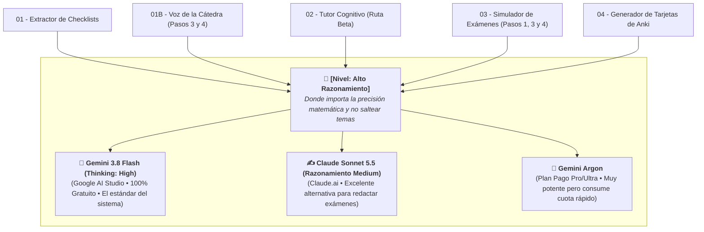
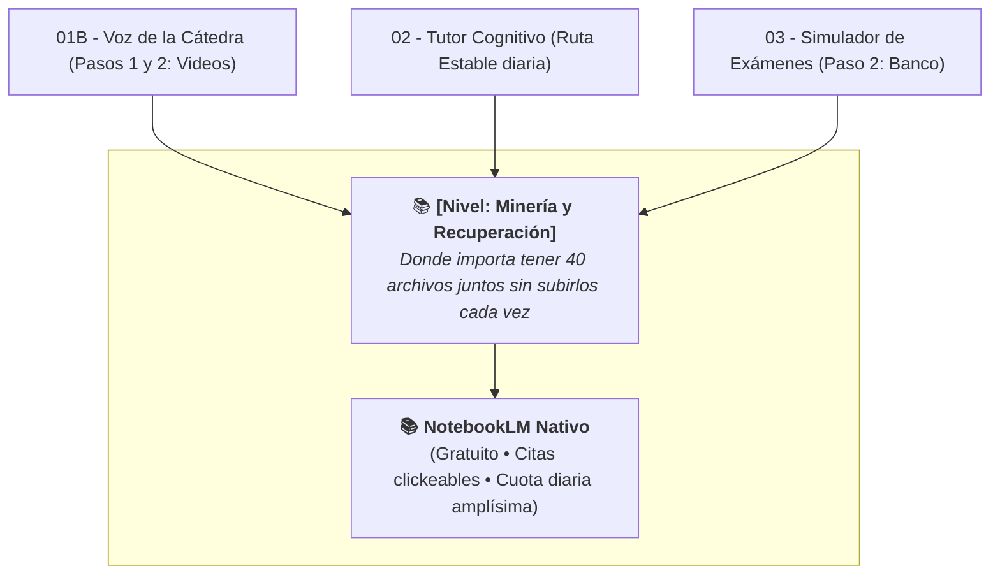

---
{"dg-publish":true,"permalink":"/20-areas/sistema-de-estudio-con-ia/05-modelos-recomendados-por-tarea/","title":"05 - Modelos Recomendados por Tarea","tags":["guia","modelos-ia","configuracion","ingenieria","ai-studio"],"dg-note-properties":{"title":"05 - Modelos Recomendados por Tarea","tags":["guia","modelos-ia","configuracion","ingenieria","ai-studio"]}}
---

# 🤖 Infraestructura de Modelos y Gestión de Cuotas

Como los modelos de Inteligencia Artificial cambian de nombre, versión y límites cada pocos meses, esta página centraliza **qué herramienta gratuita o paga conviene usar en cada paso del sistema**.

En lugar de atar las guías a un nombre comercial fijo, dividimos las tareas del sistema en **dos niveles cognitivos**:

---

## ⚖️ La Regla de Oro: Cuándo usar NotebookLM y cuándo usar Google AI Studio

Hoy existe una diferencia grande entre la **comodidad** de NotebookLM y la **inteligencia analítica** de los modelos con razonamiento profundo (*Thinking: High*):

1. **Usá NotebookLM (`[Nivel: Minería y Recuperación]`) cuando necesites consultar muchos archivos a la vez o chatear largo:**
   * Su ventaja imbatible es logística: arrastrás una sola vez los 40 archivos de la cursada (apuntes, libros, TPs, parciales y videos de YouTube) y te quedan listos para siempre con **citas clickeables**.
   * Aunque Google actualizó sus políticas y la cuota **ya no es infinita**, sigue siendo **sumamente amplia y generosa** (en la práctica es casi imposible llegar al límite diario, incluso estudiando todo el día para finales).
   * **Su punto débil:** Su modelo interno quedó rezagado. Si le pedís armar checklists o redactar un examen nuevo, resume de más, se saltea temas en silencio (*omisión silenciosa*) y se equivoca en los cálculos físicos.
2. **Usá Google AI Studio o Argon (`[Nivel: Alto Razonamiento]`) cuando necesites precisión técnica absoluta:**
   * Para armar la checklist de una unidad, diseñar el mapa de examen, redactar simulacros o crear tarjetas de Anki, necesitamos motores que "piensen paso a paso" antes de responder. Acá tenés que subir a mano desde tu PC únicamente los PDFs de la unidad que estás trabajando.

> [!DANGER] ⛔ PROHIBIDO usar el conector de Cuadernos dentro de Gemini Web (`gemini.google.com`)
> La página común de Gemini permite elegir un cuaderno de NotebookLM desde su barra lateral izquierda, pero **esa conexión funciona mal**: el modelo ignora la mayoría de los archivos del cuaderno o inventa que están vacíos. Cuando uses modelos de **`[Nivel: Alto Razonamiento]`**, subí siempre los PDFs directamente desde tu computadora en Google AI Studio (o en Argon).

---

## 📊 Matriz Rápida: Qué usar en cada Módulo

| Módulo del Sistema | Nivel Cognitivo | 🥇 Opción Principal (100% Gratuita) | 💎 Alternativa Paga / Secundaria | Motivo Práctico |
| :--- | :--- | :--- | :--- | :--- |
| **[[20. Áreas/Sistema de Estudio con IA/01 - Extractor de Checklists\|01 - Extractor de Checklists]]** | `[Alto Razonamiento]` | **Gemini 3.8 Flash (`Thinking: High`)** en Google AI Studio | **Gemini Argon** *(subiendo PDFs a mano)* | Lee diapositivas escaneadas con nitidez (`Media Res: High`) y no saltea subtemas ni ejercicios de TP. |
| **[[20. Áreas/Sistema de Estudio con IA/01B - Extractor de Clases y Voz de la Cátedra\|01B - Extractor de Clases y Voz de la Cátedra]]** | • **P1 y P2:** `[Minería]` • **P3 y P4:** `[Alto Razonamiento]` | • **P1/P2:** **NotebookLM Nativo** • **P3/P4:** **Gemini 3.8 Flash High** (AI Studio) | • **P3/P4:** **Gemini Argon** | NotebookLM lee videos de YouTube sin descargarlos y da citas clickeables; Flash High une y compacta los textos al final. |
| **[[20. Áreas/Sistema de Estudio con IA/02 - Tutor Personal Cognitivo\|02 - Tutor Personal Cognitivo]]** | • **Estable:** `[Minería]` • **Beta:** `[Alto Razonamiento]` | • **Estable:** **NotebookLM Nativo** (Prompt 27k) • **Beta:** **Gemini 3.8 Flash High** (AI Studio) | • **Beta:** **Gemini Argon** | NotebookLM para el estudio diario sin preocuparte por cuotas; AI Studio cuando el tema tiene matemática o física muy pesada. |
| **[[20. Áreas/Sistema de Estudio con IA/03 - Simulador y Generador de Exámenes de Cátedra\|03 - Simulador y Generador de Exámenes de Cátedra]]** | • **Paso 2:** `[Minería]` • **Pasos 1, 3 y 4:** `[Alto Razonamiento]` | • **P2:** **NotebookLM Nativo** • **P1/P3/P4:** **Gemini 3.8 Flash High** (AI Studio) | • **P1/P3/P4:** **Claude Sonnet 5.5 (`Medium`)** o **Gemini Argon** | NotebookLM copia rápido los 15 exámenes viejos al banco; Flash High, Sonnet o Argon redactan simulacros nuevos con cuentas válidas. |
| **[[20. Áreas/Sistema de Estudio con IA/04 - Generador de Tarjetas de Anki\|04 - Generador de Tarjetas de Anki]]** | `[Alto Razonamiento]` | **Gemini 3.8 Flash (`Thinking: High`)** en Google AI Studio | — | Permite dejar el prompt guardado en *System Instructions* y respeta sin errores el formato CSV y LaTeX. |

---

## 🔍 Detalle de cada Motor y Cómo Cuidar tus Cuotas

### 🥇 1. Gemini 3.8 Flash (`Thinking: High`) en Google AI Studio — *El Caballo de Batalla Gratuito*

- **Acceso:** 100% gratuito entrando con tu cuenta de Google en **[aistudio.google.com](https://aistudio.google.com/)**.
- **Por qué en AI Studio y no en la web común de Gemini:**
  1. Es el entorno para desarrolladores: responde de forma directa y técnica, sin filtros comerciales que acorten o simplifiquen los prompts largos.
  2. Te deja guardar tus prompts fijos en **System Instructions**.
  3. Te permite forzar **`Thinking level: High`** (máximo razonamiento paso a paso) y **`Media resolution: High`** (lectura perfecta de subíndices y gráficos en diapositivas).
  4. Sus límites diarios gratuitos son amplísimos; podés estudiar todo el cuatrimestre sin pagar un centavo.

### 📚 2. NotebookLM Nativo — *Tu Biblioteca Central*

- **Acceso:** Gratuito en **[notebook.google.com](https://notebook.google.com/)**.
- **Para qué es imbatible:** Para tener cargados todos los archivos de la materia en un solo lugar, escuchar clases grabadas en el Paso 1 de **[[20. Áreas/Sistema de Estudio con IA/01B - Extractor de Clases y Voz de la Cátedra\|Módulo 01B]]**, transcribir exámenes viejos en el Paso 2 de **[[20. Áreas/Sistema de Estudio con IA/03 - Simulador y Generador de Exámenes de Cátedra\|Módulo 03]]** y tener sesiones largas de preguntas y respuestas con el Tutor.

### ✍️ 3. Claude Sonnet 5.5 (`Razonamiento: Medium`) — *Especialista en Exámenes y LaTeX*

- **Acceso:** Plan gratuito (con límite corto de mensajes cada 5 horas) o plan Pro en **Claude.ai**.
- **Dónde brilla:** En el **Paso 4 del Simulador de Exámenes**. Redacta enunciados con tono universitario impecable y casi nunca comete errores de sintaxis en fórmulas LaTeX.
- **Cómo no quemar la cuota:** Si lo usás con el razonamiento en *High* o *Max*, agotás tu límite en un par de mensajes. Configuralo siempre en **`Medium`**, que alcanza de sobra para validar balances físicos sin quedarte sin mensajes.

### 💎 4. Gemini Argon — *El Motor de Frontera (Solo Planes Pagos)*

- **Acceso:** Exclusivo para usuarios con suscripción paga de Google (AI Pro / Ultra).
- **Estado actual y rendimiento:** Aunque todavía lo estoy terminando de testear en cursadas completas, en las pruebas que hice demostró ser **lo más potente que vi hasta hoy**, superando tanto a Claude Sonnet 5.5 como a Flash 3.8 High en estructuración de mapas y resolución de problemas complejos.
- **El gran cuidado (Consume muchísima cuota):** Es un modelo pesado que devora tu límite de tokens a una velocidad altísima. Si tenés plan pago, **no lo desperdicies en charlas largas del Tutor ni copiando enunciados**: reservalo como un bisturí para tareas puntuales de 1 o 2 mensajes, como armar el `mapa.md` o generar los paquetes finales de examen en el **[[20. Áreas/Sistema de Estudio con IA/03 - Simulador y Generador de Exámenes de Cátedra\|Módulo 03]]** y las checklists de materias troncales en el **[[20. Áreas/Sistema de Estudio con IA/01 - Extractor de Checklists\|Módulo 01]]**.

### ⛔ Modelos que NO tenés que usar en este sistema

- **Gemini Pro 3.1:** Rinde peor que `Gemini 3.8 Flash (Thinking: High)`, tiende a resumir las checklists por pereza y suele meter errores de comillas en los archivos CSV de Anki.
- **Gemini Flash-Lite:** Es demasiado básico para seguir las reglas de estos prompts; inventa datos y rompe los formatos.

---

> [!INFO] 📜 Registro de cambios de modelos
> Para ver la historia completa de qué modelos y flujos se descartaron en versiones anteriores y por qué, consultá **[[20. Áreas/Sistema de Estudio con IA/99 - Historial de Versiones (Changelog)\|99 - Historial de Versiones (Changelog)]]**.

---

## 🧭 Navegación

*Volver a la herramienta anterior:* ⬅️ **[[20. Áreas/Sistema de Estudio con IA/04 - Generador de Tarjetas de Anki\|04 - Generador de Tarjetas de Anki]]**
*Módulo satélite de clases grabadas:* 🎙️ **[[20. Áreas/Sistema de Estudio con IA/01B - Extractor de Clases y Voz de la Cátedra\|01B - Extractor de Clases y Voz de la Cátedra]]**
*Ir a la biblioteca de fundamentos:* ➡️ **[[20. Áreas/Sistema de Estudio con IA/06 - Biblioteca de Ciencia del Aprendizaje\|06 - Biblioteca de Ciencia del Aprendizaje]]**