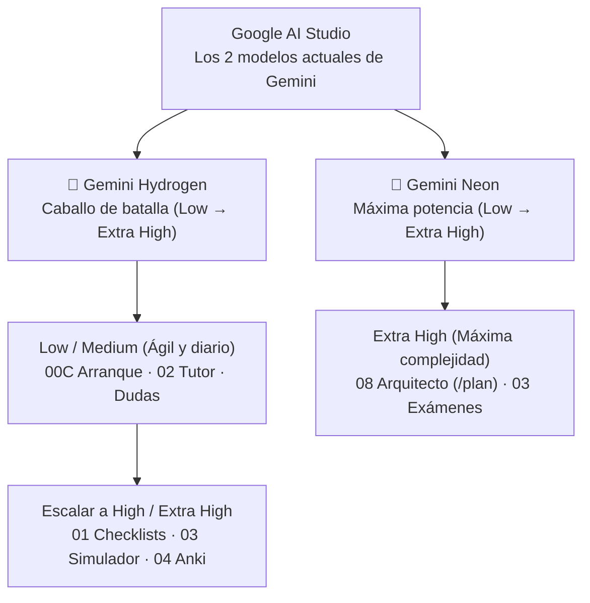

---
{"dg-publish":true,"permalink":"/20-areas/sistema-de-estudio-con-ia/05-modelos-recomendados-por-tarea/","title":"05 - Modelos Recomendados por Tarea","tags":["guia","modelos-ia","configuracion","ingenieria","ai-studio"],"dg-note-properties":{"title":"05 - Modelos Recomendados por Tarea","tags":["guia","modelos-ia","configuracion","ingenieria","ai-studio"]}}
---

# 🤖 Infraestructura de Modelos y Gestión de Cuotas

Como los modelos de Inteligencia Artificial cambian de nombre y límites cada pocos meses, esta página centraliza **qué motor conviene usar en cada módulo del sistema** para tener máxima precisión técnica sin quemar cuota al pedo.

Hoy Google reemplazó sus modelos anteriores por **dos motores principales** en [Google AI Studio](https://aistudio.google.com/): **Gemini Hydrogen** (de `Low` a `Extra High`, el caballo de batalla súper económico para casi todo) y **Gemini Neon** (de `Low` a `Extra High`, la máxima potencia disponible para tareas muy complejas). Con este salto, **NotebookLM queda hoy muy poco recomendado**, ya que en prácticamente cualquier tarea rinden mejor Hydrogen o Neon.

---

## ⚙️ Las 3 Reglas de Oro del Ecosistema

1. **Usá `Gemini Hydrogen` (`Low` → `Extra High`) en Google AI Studio como caballo de batalla para casi todo:**
   * Es buenísimo y **súper barato en cuota**, cubriendo prácticamente el 90 % del flujo de estudio:
     * **`Low`:** Muy rápido (tipo *Flash*) y sólido para respuestas inmediatas (`00C - Copiloto ARRANQUE` o dudas puntuales leyendo en papel).
     * **`Medium`:** El nivel ideal para el **Tutor Personal Cognitivo (`02`)** y consultas del día a día; rinde muy bien gastando poquísima cuota.
     * **`High`:** Excelente balance para checklists (`01`), unión de clases (`01B`), tarjetas de Anki (`04`), modo emergencia (`00B`) y simulacros estándar (`03`).
     * **`Extra High`:** Rinde al nivel del antiguo *Argon High* (o incluso un poco mejor) a una fracción del costo; ideal para exámenes exigentes (`03`) o temarios extensos (`01`) sin gastar cuota pesada.
   * Activá siempre **`Media resolution: High`** en AI Studio cuando subas PDFs con gráficos, tablas o diapositivas escaneadas.

2. **Reservá `Gemini Neon` (`Extra High`) para las tareas más complejas:**
   * Aunque corre desde `Low` hasta `Extra High`, su mayor valor diferencial está en **`Extra High`**, donde es el motor más potente disponible.
   * Es la mejor opción para tareas de diseño y razonamiento profundo, especialmente el **Arquitecto de Aprendizaje (`08`) al armar el `/plan` en 3 pasos** (o `/completo`), así como simulacros integradores muy largos o complejos (`03`).

3. **NotebookLM queda hoy muy poco recomendado *(y nunca lo conectes desde Gemini Web)*:**
   * En prácticamente cualquier módulo del sistema (incluido el Tutor `02` y el Simulador `03`), hoy vas a obtener mejores respuestas y mayor adherencia subiendo los PDFs de la unidad a **Google AI Studio (`Hydrogen` o `Neon`)** que usando NotebookLM.
   * NotebookLM solo conserva un nicho secundario puntual si querés cargar ~40 archivos juntos para consultar citas clickeables o procesar links de YouTube sin descargar videos (`01B` Pasos 1 y 2).
   * **Error crítico a evitar:** nunca uses el conector lateral de cuadernos de NotebookLM dentro de `gemini.google.com` porque falla al indexar e ignora archivos enteros. Subí siempre tus PDFs desde tu PC en Google AI Studio.

---

## 📊 Matriz de Modelos por Guía

| Guía / Herramienta | Nivel Cognitivo | 🥇 Opción Recomendada | Alternativa | Motivo Técnico |
| :--- | :--- | :--- | :--- | :--- |
| **[[20. Áreas/Sistema de Estudio con IA/01 - Extractor de Checklists\|01 - Extractor de Checklists]]** | `[Alto Razonamiento]` | **Gemini Hydrogen (`High` o `Extra High`)** en AI Studio | **Gemini Neon (`High` / `Extra High`)** *(temarios gigantes)* | Lee diapositivas escaneadas con nitidez (`Media Res: High`), no saltea subtemas ni ejercicios y gasta poquísima cuota. |
| **[[20. Áreas/Sistema de Estudio con IA/01B - Extractor de Clases y Voz de la Cátedra\|01B - Extractor de Clases y Voz de la Cátedra]]** | • **P1 y P2:** `[Extracción]` • **P3 y P4:** `[Alto Razonamiento]` | • **P1/P2:** **Hydrogen (`Medium` / `High`)** *(o NotebookLM si pegás link de YouTube)* • **P3/P4:** **Hydrogen (`High` / `Extra High`)** | **Gemini Neon (`High` / `Extra High`)** *(cierres muy extensos)* | Si tenés la transcripción o audio, Hydrogen rinde mejor; NotebookLM queda solo como atajo cómodo para pegar links de YouTube sin descargarlos. |
| **[[20. Áreas/Sistema de Estudio con IA/02 - Tutor Personal Cognitivo\|02 - Tutor Personal Cognitivo]]** | `[Diario / Riguroso]` | **Gemini Hydrogen (`Medium`)** en AI Studio *(Prompt V3)* | **Hydrogen (`High` / `Extra High`)** o **Neon** *(deducciones muy difíciles)* · NotebookLM *(secundario)* | **Hydrogen en `Medium`** funciona excelente para el Tutor y el estudio diario manteniendo contexto, micro-pacing y cuentas sólidas. |
| **[[20. Áreas/Sistema de Estudio con IA/03 - Simulador y Generador de Exámenes de Cátedra\|03 - Simulador y Generador de Exámenes de Cátedra]]** | `[Alto Razonamiento]` | **Gemini Hydrogen (`High` / `Extra High`)** en AI Studio *(Pasos 1 a 4)* | **Gemini Neon (`Extra High`)** *(simulacros muy largos o complejos)* | En `Extra High`, Hydrogen iguala o supera al viejo Argon High; para exámenes integradores de máxima dificultad, Neon `Extra High` es imbatible. |
| **[[20. Áreas/Sistema de Estudio con IA/04 - Generador de Tarjetas de Anki\|04 - Generador de Tarjetas de Anki]]** | `[Alto Razonamiento]` | **Gemini Hydrogen (`Medium` o `High`)** | **Hydrogen (`Extra High`)** si el apunte es muy denso | Guardás el prompt en *System Instructions*; Hydrogen respeta CSV y LaTeX limpio sin comillas rotas. |
| **[[20. Áreas/Sistema de Estudio con IA/00C - Copiloto ARRANQUE (Vencer la Procrastinación)\|00C - Copiloto ARRANQUE (Vencer la Procrastinación)]]** | `[Ágil / Cotidiano]` | **Gemini Hydrogen (`Low` o `Medium`)** | **Gemini Web** (chat rápido) | En **`Low`** es rapidísimo (estilo *Flash*) y en **`Medium`** sostiene perfecto las reglas para destrabar el arranque con fricción mínima. |
| **[[20. Áreas/Sistema de Estudio con IA/08 - Sistema de Estudio Tradicional (En Papel o con IA Simple)\|08 - Sistema de Estudio Tradicional (En Papel o con IA Simple)]]** *(Arquitecto v6.0)* | `[Diseño Complejo]` / `[Diario]` | • **Para `/plan` (3 pasos) o `/completo`:** **Gemini Neon (`Extra High`)** • **Sesión diaria (`/siguiente`, `!libre`):** **Hydrogen (`Medium` / `High`)** | **Hydrogen (`Extra High`)** para `/plan` si querés cuidar cuota | Neon en `Extra High` es lo mejor disponible para diseñar la estrategia macro en 3 pasos; Hydrogen en `Medium` acompaña el día a día muy rápido y barato. |
| **[[20. Áreas/Sistema de Estudio con IA/00B - Modo Emergencia (Ruta Rápida con IA)\|00B - Modo Emergencia (Ruta Rápida con IA)]]** | Según vía (`08`/`03`/`02`) | **Gemini Hydrogen (`High` / `Extra High`)** o **Neon (`Extra High`)** *(en `/emergencia`)* | **Hydrogen (`Medium`)** para el Tutor enfocado | Prioriza precisión directa al formato de examen sin perder tiempo ni quemar cuota innecesaria. |

---

## 🔍 Análisis Detallado por Motor

### 🚀 1. Gemini Hydrogen (`Low` → `Extra High`) — *El Caballo de Batalla*
- **Acceso:** **[Google AI Studio](https://aistudio.google.com/)** (panel derecho *Run settings*).
- **Por qué cubre casi todo el sistema:** Es muy económico y responde excelente en toda su escala de razonamiento:
  - **`Low`:** Ultra rápido (estilo *Flash*) y confiable para consultas cortas, dudas en papel y `00C - Copiloto ARRANQUE`.
  - **`Medium`:** El punto dulce para estudiar todos los días: **Tutor Personal Cognitivo (`02`)**, consultas cotidianas, seguimiento con el Arquitecto (`08`) y generación de tarjetas (`04`).
  - **`High`:** Gran equilibrio para tareas estructuradas (`01 - Checklists`, `01B` consolidación, `03 - Simulador`, `04 - Anki`).
  - **`Extra High`:** Rinde al nivel del viejo *Argon High* (o un poco mejor) con un costo mínimo; ideal para trabajos densos sin pasar a un modelo pesado.
- **Configuración recomendada en AI Studio:** Subir los PDFs de la unidad desde tu PC, elegir `Thinking level` según la tarea y activar **`Media resolution: High`** cuando haya gráficos, tablas o escaneos.

### 💎 2. Gemini Neon (`Low` → `Extra High`) — *Máxima Potencia de Razonamiento*
- **Acceso:** **[Google AI Studio](https://aistudio.google.com/)**.
- **Cuándo usarlo:** Disponible desde `Low` hasta `Extra High`, brilla especialmente en **`Extra High`** como el modelo más potente para tareas de altísima complejidad:
  - Armar el **`/plan` en 3 pasos** (o `/completo`) del **Arquitecto de Estudio (`08` v6.0)** sobre apuntes y exámenes reales.
  - Generar o corregir **simulacros integradores muy exigentes (`03`)** o deducciones largas donde querés cero margen de error.
- **Consejo de cuota:** Usalo para las piezas de diseño o máxima exigencia y pasate a **Hydrogen (`Medium` / `High`)** para la práctica diaria.

### 📚 3. NotebookLM Nativo — *Uso Secundario / Poco Recomendado*
- **Acceso:** Gratuito en **[notebook.google.com](https://notebook.google.com/)**.
- **Por qué quedó relegado:** Con **Hydrogen** y **Neon** en AI Studio, hoy prácticamente cualquier tarea del sistema (Tutor, Checklists, Simulador, Anki) rinde mucho mejor subiendo los archivos de la unidad a AI Studio. Dejalo únicamente como biblioteca opcional si querés tener ~40 archivos juntos con citas clickeables o pegar links de YouTube sin descargarlos en `01B` (Pasos 1 y 2).

---

> [!note]- 💬 ¿Qué pasa con modelos de otras empresas (Claude, ChatGPT, DeepSeek, Qwen)?
> **No he probado personalmente** modelos de otras empresas como **Claude**, **ChatGPT**, ni modelos chinos como **DeepSeek** o **Qwen** con estos prompts. Toda la guía está calibrada y probada en la práctica sobre los dos modelos actuales de Google (**Gemini Hydrogen** y **Gemini Neon** en Google AI Studio).
>
> Si probás cualquiera de estos prompts en **Claude**, **ChatGPT**, **DeepSeek**, **Qwen** u otro modelo y querés contarme cómo te fue (qué respetó bien, dónde se trabó o si necesitó algún ajuste), escribime a **[duiliobtorres@gmail.com](mailto:duiliobtorres@gmail.com)** así sumo referencias reales para el resto.

---

> [!INFO] 📜 Registro de cambios de modelos
> Para ver el historial de cambios y evolución de las herramientas, consultá **[[20. Áreas/Sistema de Estudio con IA/99 - Historial de Versiones (Changelog)\|99 - Historial de Versiones (Changelog)]]**.

---

## 🧭 Navegación

*Volver al inicio y selector de ruta:* 🏠 **[[20. Áreas/Sistema de Estudio con IA/00 - Inicio y Flujo de Trabajo\|00 - Inicio y Flujo de Trabajo]]**
*Tutorial de importación a Anki (Paso 4B):* ⬅️ **[[20. Áreas/Sistema de Estudio con IA/04B - Importación a Anki e Image Occlusion (Tutorial Visual)\|04B - Importación a Anki e Image Occlusion (Tutorial Visual)]]**
*Urgencias y bloqueo:* 🚨 **[[20. Áreas/Sistema de Estudio con IA/00B - Modo Emergencia (Ruta Rápida con IA)\|00B - Modo Emergencia (Ruta Rápida con IA)]]** · 🚀 **[[20. Áreas/Sistema de Estudio con IA/00C - Copiloto ARRANQUE (Vencer la Procrastinación)\|00C - Copiloto ARRANQUE (Vencer la Procrastinación)]]**
*Siguiente sección (Biblioteca científica):* ➡️ **[[20. Áreas/Sistema de Estudio con IA/06 - Biblioteca de Ciencia del Aprendizaje\|06 - Biblioteca de Ciencia del Aprendizaje]]**