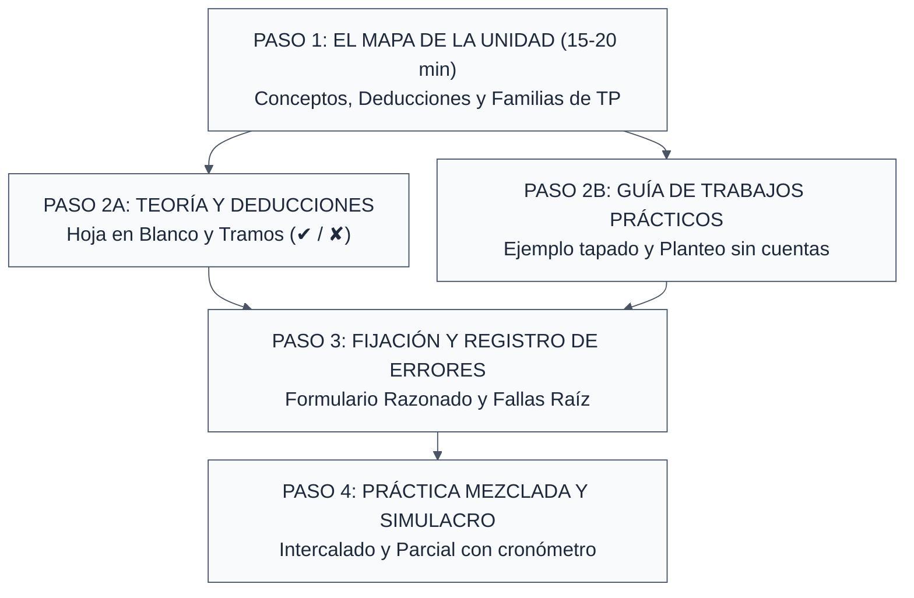

---
{"dg-publish":true,"permalink":"/20-areas/sistema-de-estudio-con-ia/08-sistema-de-estudio-tradicional-en-papel-o-con-ia-simple/","title":"08 - Sistema de Estudio Tradicional (En Papel o con IA Simple)","tags":["guia","estudio-activo","metodo-tradicional","ingenieria"],"dg-note-properties":{"title":"08 - Sistema de Estudio Tradicional (En Papel o con IA Simple)","tags":["guia","estudio-activo","metodo-tradicional","ingenieria"]}}
---

# 📝 Sistema de Estudio Tradicional: Cómo Estudiar Ingeniería en Papel (o con IA Simple)

> [!tip] 📌 ¿Para quién es esta guía?
> Si no tenés ganas de configurar prompts largos, no te llevás bien con Anki, preferís estudiar con **apuntes impresos, cuaderno, birome y calculadora**, o simplemente querés usar una IA común (ChatGPT, Gemini o Claude) haciéndole preguntas normales sin armar todo el sistema automatizado de esta web, **este es tu mapa de ruta**.

> [!abstract] Principio Rector del Método
> La realidad es una sola: **los prompts avanzados y las automatizaciones no hacen el milagro; lo que aprueba parciales y finales difíciles es el método cognitivo que hay detrás**.
>
> Este flujo traduce las mismas 4 fases del sistema principal a un método **100% de escritorio y papel**, basado exactamente en los mismos 7 libros científicos de nuestra **[[20. Áreas/Sistema de Estudio con IA/06 - Biblioteca de Ciencia del Aprendizaje\|06 - Biblioteca de Ciencia del Aprendizaje]]** y en las **[[20. Áreas/Sistema de Estudio con IA/07 - Índice de Guías y Checklists de Aprendizaje\|Checklists de Autoevaluación (07)]]**.

---

## 🔄 Equivalencia: Sistema Automatizado vs. Sistema Tradicional

Ambos caminos entrenan tu cerebro bajo las mismas reglas; solo cambia la herramienta:

| Etapa del Aprendizaje | 🤖 Con el Sistema de IA (`01` a `04`) | 📝 En Papel / IA Simple (Esta Guía) | Principios asociados (`[[06 - Biblioteca de Ciencia del Aprendizaje\|06]]`) |
| :--- | :--- | :--- | :--- |
| **1. Hoja de Ruta** | **[[20. Áreas/Sistema de Estudio con IA/01 - Extractor de Checklists\|01 - Extractor de Checklists]]** en AI Studio. | **El Mapa en 1 Carilla:** Escaneo de 20 min de apuntes, guía de TP y parciales viejos. | *Chunking* y catálogo de arquetipos (*Oakley / Newport*). |
| **2. Estudio y Práctica** | **[[20. Áreas/Sistema de Estudio con IA/02 - Tutor Personal Cognitivo\|02 - Tutor Personal Cognitivo]]** (micro-pacing socrático). | **El Ejemplo Tapado + Deducciones por Tramos + Planteo sin Álgebra.** | Efecto del ejemplo resuelto y recuperación activa (*Barton / Make It Stick*). |
| **3. Memoria y Errores** | **[[20. Áreas/Sistema de Estudio con IA/04 - Generador de Tarjetas de Anki\|04 - Generador de Tarjetas de Anki]]** + repetición espaciada. | **El Formulario Razonado (1 carilla) + Bitácora de «Fallas Raíz»** (reintentar en días distintos). | Práctica deliberada y ataque al eslabón débil (*Ericsson / Agarwal*). |
| **4. Simulacro Real** | **[[20. Áreas/Sistema de Estudio con IA/03 - Simulador y Generador de Exámenes de Cátedra\|03 - Simulador y Generador de Exámenes de Cátedra]]**. | **El Sorteo de Parciales Viejos:** Problemas mezclados sin título y con reloj. | Transferencia directa e intercalado (*Scott Young / Make It Stick*). |

---

## 🗺️ El Flujo de 4 Pasos en Papel

> [!info]+ Detalle Operativo de las 4 Etapas del Diagrama
> - **PASO 1: EL MAPA DE LA UNIDAD (15–20 min)**
>   - Mirás apuntes, guía de TP y parciales viejos.
>   - Anotás en 1 carilla: Conceptos, Deducciones y Familias de ejercicios.
> - **PASO 2A: TEORÍA Y DEDUCCIONES**
>   - Técnica de la Hoja en Blanco.
>   - Deducciones divididas en 4 a 6 tramos ($\checkmark$ / $\times$).
> - **PASO 2B: GUÍA DE TRABAJOS PRÁCTICOS**
>   - Ejemplo resuelto tapado.
>   - Dibujo previo + Planteo sin cuentas ($\text{Ecuaciones} = \text{Incógnitas}$).
> - **PASO 3: FIJACIÓN Y REGISTRO DE ERRORES**
>   - Formulario Razonado (Fórmula + Hipótesis al lado).
>   - Lista de «Fallas Raíz» (Reintentar al día siguiente y días después).
> - **PASO 4: ENTRENAMIENTO MEZCLADO Y SIMULACRO**
>   - Intercalar ejercicios de distintas unidades.
>   - Parcial viejo a mano, con tablas y cronómetro.

---

## Paso 1: El Mapa de la Unidad en 20 Minutos (Antes de estudiar)

> [!warning] El error de arrancar a ciegas
> El error más común en ingeniería es abrir el apunte en la página 1 y ponerse a subrayar o intentar hacer la guía del ejercicio 1 al 30 como un robot. Antes de estudiar una unidad nueva, invertí **20 minutos** en armar tu mapa en una hoja A4 *(método inspirado en Cal Newport)*:

- [x] **1. Opcional, 2–3 minutos antes de abrir el apunte:** En una hoja borrador, anotá todo lo que recordás o intuís de la unidad. No importa que esté incompleto: te muestra de dónde partís y te prepara para fijarte en lo que no sabías.
- [x] **2. Mirá el final de la película primero (Parciales viejos):** Buscá 2 o 3 exámenes anteriores de la cátedra y fijate qué problemas o preguntas tomaron de esta unidad. Eso te dice de entrada qué nivel de profundidad exigen.
- [x] **3. Dividí tu hoja en tres columnas rápidas:**
  - **Teoría y Gráficos clave:** ¿Qué fenómenos o curvas aparecen en las diapositivas/apuntes? *(ej. Diagrama $T$-$s$ del ciclo Rankine, Curva tensión-deformación, Diagrama de Moody)*.
  - **Demostraciones / Deducciones:** ¿Qué ecuaciones desarrolla el profesor paso a paso en el pizarrón?
  - **Familias de Problemas (Arquetipos del TP):** Mirá la guía práctica y agrupá los ejercicios parecidos. En vez de ver "20 ejercicios sueltos", vas a notar que hay 3 o 4 familias *(ej. Ej. 1 a 4: cañerías en serie; Ej. 5 a 8: cañerías en paralelo; Ej. 9 y 10: bomba acoplada a red)*.

> [!tip] Tu propia Checklist manual
> Con esa hoja a la vista ya tenés tu propia **Checklist manual**: sabés qué tenés que dominar para dar la unidad por terminada. Veinte minutos es una referencia, no una garantía de cobertura: si la unidad es grande, ajustá.

---

## Paso 2: Cómo Estudiar la Teoría y Hacer la Guía (Sin autoengañarte)

> [!warning] El Enemigo Número Uno: La Ilusión de Competencia (*A Mind for Numbers*)
> En *A Mind for Numbers*, Barbara Oakley explica que el enemigo número uno del estudiante de ingeniería es la **ilusión de competencia**: leer el apunte o mirar cómo el ayudante resuelve en el pizarrón, sentir *"ah, claro, tiene todo el sentido del mundo"*, y descubrir en el parcial que frente a la hoja vacía no sabés ni por dónde arrancar.
>
> > [!zap] Regla de Oro del Estudio Activo
> > Para destruir esa ilusión, separá tu estudio en dos dinámicas activas. En ambas vale la misma regla: **no alcanza con reproducir los pasos; tenés que poder decir por qué se hace cada uno y bajo qué hipótesis vale** (escribilo al margen o decilo en voz alta).

> [!NOTE] 📈 Gráfico 1: Dinámica de Retención — Curva del Olvido vs. Práctica Activa Espaciada
> -1792587781401.webp)
### A. Para estudiar Teoría y Demostraciones (Hoja en Blanco y Tramos)

1. **Evitá copiar y releer:**
   No pases el apunte en limpio con colores. Leé una sección corta tratando de entender el *porqué* físico, **cerrá el cuaderno**, agarrá una hoja borrador y **escribí o dibujá todo lo que te acuerdes desde cero** (definición, gráfico con sus ejes rotulados, ecuación y cuándo vale). Recién cuando te vacíes, abrí el apunte y corregite con otro color. Sí sirve armar un mapa o resumen *de memoria y con tus palabras*.

   > [!tip] Regla de calibración
   > Para que esto funcione, el esfuerzo tiene que costar, pero ser posible con lo que ya sabés, y terminar con corrección. Si no te sale absolutamente nada, no es esfuerzo útil: bajá un escalón (mirá una pista o el ejemplo) y volvé a intentar.

2. **El método de los «Tramos» para deducciones largas:**
   En vez de intentar memorizar dos carillas de álgebra de corrido, hacé esto:
   - Entendé **de dónde parte** (qué modelo físico y qué hipótesis asume) y **adónde llega**.
   - Dividí la demostración en **4 a 6 escalones lógicos** (donde cada escalón termina en una ecuación intermedia importante) y anotá al margen **qué hipótesis física destraba ese paso** *(ej. "acá uso fluido incompresible $\rho = \text{cte}$", "acá desprecio variación de energía potencial")*.
   - Tapá la hoja y reconstruila en limpio. Si te trabás en el escalón 3, espiá **solo ese renglón** y seguí solo hasta el final. Ponete un **✓** en los tramos que salieron y una **✗** donde espiaste. Al día siguiente, practicá solo los que tenían **✗**.

### B. Para resolver la Guía de Trabajos Prácticos

1. **La técnica del «Ejemplo Resuelto Tapado» (*Craig Barton*):**
   Cuando el tema es nuevo, no te tires a ciegas ni copies la receta cambiando los números. Agarrá el primer ejemplo resuelto de la clase o del libro, leé línea por línea preguntándote *"¿por qué puso este signo?, ¿de dónde sacó este dato?"*. Una vez que lo entendiste, **tapalo por completo y resolvelo vos solo en una hoja en blanco**. Si no podés resolverlo después de haberlo estudiado, todavía necesitás practicarlo: revisá dónde te trabaste y volvé a intentarlo sin mirar.

   > [!tip] Escalón intermedio (Si el tema es muy nuevo - opcional)
   > Antes de ir al problema completo solo, hacé un escalón intermedio: el mismo ejemplo con los últimos pasos en blanco para que los completes vos.

2. **Intentá identificar tu traba antes de pedir ayuda:**
   Cuando encares un ejercicio nuevo de la guía, **intentá plantearlo solo aunque no veas el camino, y tratá de ubicar dónde exactamente te trabás**. Unos minutos, no horas: si no avanzás, pedí una pista o mirá un renglón del resuelto y volvé a hacerlo solo. Si al primer minuto mirás el resuelto de otro año, tu cerebro entrena *reconocer* soluciones ajenas, no *crear* planteos propios.

3. **Primero el dibujo, después las letras y al final los números:**
   Cuando el problema tenga una configuración física o espacial relevante, dibujá primero el esquema (diagrama de cuerpo libre, volumen de control en líneas punteadas, ejes coordenados $x\text{-}y$ y sentido positivo adoptado). En materias de cálculo o álgebra, donde no hay un dibujo físico, reemplazalo por un **esquema de signos, de dependencias entre variables o del comportamiento de la función** (asíntotas, crecimiento, signo).

4. **Entrená el «Planteo Cerrado sin Álgebra»:**
   Cuando tengas poco tiempo o una guía larguísima, elegí 3 o 4 problemas y hacé **únicamente el planteo completo**: dibujás el esquema, listás las hipótesis, escribís las ecuaciones en letras, **contás que tengas exactamente tantas ecuaciones independientes como incógnitas**, y sobre todo entendés todo lo que hacés. En ingeniería, gran parte de la dificultad está en el planteo, pero **practicá también los despejes y las cuentas completas con reloj**, porque en el parcial el tiempo corre y el álgebra también se entrena.

5. **Control físico del resultado:**
   Antes de recuadrar un número, frená 10 segundos: ¿tiene unidades?, ¿el signo coincide con mi dibujo?, ¿el orden de magnitud es lógico (o me dio que por un caño doméstico pasa el caudal del río Paraná)?, ¿qué da esta expresión si el ángulo vale $0^\circ$ o la masa tiende a cero?

> [!NOTE] 📸  Gráfico 2: Metodología Canónica de Resolución — Del Esquema Físico (DCL) al Planteo Simbólico Cerrado
> -1792587710730.webp)

---

## Paso 3: Cómo Recordar Fórmulas y No Repetir Errores (Sin usar Anki)

Si no querés usar programas de tarjetas como Anki, necesitás dos herramientas en papel que cumplen una función parecida en la mitad de tiempo *(con la condición de volver a ellas en días distintos, no una sola vez)*:

### 1. El «Formulario Razonado» de 1 Carilla por Unidad

No hagas una lista muda de ecuaciones sueltas ($Q = A \cdot v$), porque en el parcial el profesor te cambia una condición y aplicás una fórmula donde no vale. Armá una sola carilla A4 por unidad con este formato de tres columnas:

| Ecuación / Relación                                                | Hipótesis obligatorias (¿Cuándo vale?)                                                                                                                                                                     | Trampa típica / Unidades / Gráfico                                                                                                                                                                 |
| :----------------------------------------------------------------- | :--------------------------------------------------------------------------------------------------------------------------------------------------------------------------------------------------------- | :------------------------------------------------------------------------------------------------------------------------------------------------------------------------------------------------- |
| **Bernoulli ideal:** $P_1/\gamma + z_1 + v_1^2/2g = \text{cte}$ | 1. Fluido incompresible ($\rho=\text{cte}$) 2. Flujo invíscido (sin pérdidas) 3. Régimen estacionario 4. A lo largo de una línea de corriente 5. Sin intercambio de trabajo de eje ni de calor | • ¡No vale tal cual si hay una bomba o turbina en el medio! (ahí sumar $H_B$ o restar $H_T$; con pérdidas, agregar $h_f$). • Presiones en la misma base (ambas manométricas o ambas absolutas). |

> [!NOTE] 📸 Gráfico 3: Esquema Mental del Formulario Razonado — Cuándo Cambia el Modelo (Límites de Bernoulli)
> -1792587738124.webp)

> [!tip]+ ¿Cómo usar esta carilla según la modalidad del examen?
> - **Si el examen es SIN hoja de fórmulas:** Dos veces por semana, guardá esa carilla e intentá escribirla y dibujar sus gráficos de memoria en una hoja borrador.
> - **Si el examen es CON hoja de fórmulas:** Esa misma carilla (limpia según lo que permita tu cátedra) ya es el machete legal perfecto para llevar al parcial.

### 2. La Bitácora de «Fallas Raíz» *(inspirada en la práctica deliberada de Anders Ericsson)*

Dedicá la última hoja de tu cuaderno a anotar **cada ejercicio o pregunta teórica donde te trabaste o te dio mal**, pero prohibido anotar solo *"hacer de nuevo el Ej. 7"*. Anotá en un renglón **cuál fue tu falla raíz**:

> [!example]+ Ejemplos de registro en tu Bitácora
> - `[TP3 - Ej. 4]` *Olvidé pasar la temperatura a Kelvin antes de meterla en gases ideales.*
> - `[TP4 - Ej. 8]` *Puse mal el signo del trabajo de expansión porque no declaré mi convención al principio.*
> - `[Parcial 2024 - Ej. 2]` *No supe qué estado usar a la salida de la válvula (olvidé que el estrangulamiento es isoentálpico $h_1 = h_2$).*

> [!warning]+ Clasificá cada falla según su causa, porque el remedio cambia
> - **De concepto** (no sabías la teoría) ➔ volvé al apunte.
> - **De estrategia** (elegiste mal el modelo) ➔ practicá clasificar enunciados.
> - **De cuentas** (despeje, método matemático) ➔ practicá ese cálculo suelto.
> - **De descuido** (signos, unidades) ➔ armá una lista de chequeo corta y usala.

> [!zap] La regla de oro del cuaderno de errores
> Reintentá el ejercicio fallado **al día siguiente** desde una hoja en blanco y sin espiar, y **de nuevo unos días después**; si sigue fallando, volvé a intentarlo más adelante. **Tachalo de la lista recién cuando te sale en un problema parecido**, no solo en el mismo enunciado que ya te acordás.

---

## Paso 4: Intercalar Temas y Hacer el Simulacro Real

> [!warning] La trampa invisible del estudio en bloques
> Estudiar la Unidad 1 el lunes, la Unidad 2 el martes y la Unidad 3 el miércoles te da una trampa invisible: cuando estás haciendo la guía 3, **ya sabés de antemano que todos los problemas salen con las fórmulas de la guía 3**. En el parcial, los problemas vienen sin cartelito.

1. **Práctica Intercalada (*Interleaving*):**
   Primero tenés que saber resolver cada tipo de problema por separado. Una vez que lo lograste, empezá a mezclar: en una misma tarde resolvé **un ejercicio del tema de hoy + uno de la semana pasada + una demostración de la Unidad 1**. Ese esfuerzo mental de preguntarte *"¿con qué modelo sale esto?"* es exactamente lo que te evalúan en el examen.
   - *Un ejercicio extra, de vez en cuando:* Juntá varios enunciados mezclados y decí **solo qué modelo e hipótesis usarías**, sin calcular.

2. **La Técnica de las «Rondas ✓ / ✗» para finales o teoría:**
   Armate una lista de 15 o 20 preguntas exigentes de toda la materia (sacadas de parciales/finales viejos). Hacé la **Ronda 1**: respondés todas sin mirar apuntes y te calificás sin piedad con **✓** o **✗**. En la **Ronda 2** (al otro día), no repasás todo de nuevo: te tomás **únicamente las que tuvieron ✗**, hasta que no quede ninguna. *(Opcional: antes de corregir, anotá "creo que me salió: 1 a 5" y compará; si siempre te sobreestimás, sabés menos de lo que creés).*

3. **El Simulacro con Cronómetro:**
   Cuando ya tengas una base y te quede margen para corregir lo que descubras, agarrá un parcial viejo completo que no hayas resuelto todavía. Guardá el celular en otra pieza, dejá arriba de la mesa **solo la calculadora y las tablas que te dejan usar en el aula**, poné una alarma con el tiempo real del examen y hacelo de punta a punta sin espiar una sola hoja.
   - *Después, hacete dos preguntas:* **¿Dónde perdí tiempo?** y **¿Qué tipo de error fue cada uno?** (usá la clasificación de la bitácora). Eso te muestra qué ajustar con el tiempo que te queda.

> [!quote] Un hábito más
> **Un hábito más:** No estudies todo la noche anterior; dormir bien también es parte del método.

---

## 💡 Cómo usar una IA común (ChatGPT, Gemini o Claude) SIN configurar nada

Si querés apoyarte en cualquier chat de IA gratuito mientras estudiás en papel, sin usar ninguno de los prompts largos de esta web, alcanza con que cumplas estas **4 reglas de supervivencia**:

1. **Nunca le pidas «Resolveme este ejercicio»:**
   Si le sacás una foto al enunciado y leés cómo lo resuelve la IA, te estás robando el entrenamiento. Escribile siempre:

   > [!example] Prompt 1: Pedir pistas graduales sin spoiler
   > *"Estoy intentando resolver este problema: [pegar enunciado]. Yo planteé esto: [contarle qué pensaste o subir foto de tu hoja]. **No me des la resolución ni el resultado final**: decime únicamente si mi planteo físico es correcto o dame una sola pista, una a la vez, para el paso donde me trabé."*

2. **Usala para destrabar el significado físico:**
   Cuando el apunte tire una ecuación que parece imposible, preguntale:

   > [!example] Prompt 2: Traducir ecuaciones a intuición física
   > *"Explicame con intuición física para ingeniería mecánica qué representa cada término de esta ecuación, bajo qué hipótesis vale y dame un ejemplo real donde falle."*

3. **Pedile que te arme un «problema gemelo»:**
   Cuando por fin pudiste destrabar un ejercicio difícil mirando la resolución de la cátedra, comprobalo en el acto:

   > [!example] Prompt 3: Verificar transferencia con un problema gemelo
   > *"Acabo de entender cómo se resuelve este ejercicio: [pegar ejercicio]. Inventame un problema parecido que se resuelva con la misma lógica física pero cambiando la configuración o invirtiendo qué es dato y qué es incógnita, sin darme la solución. Esperá a que yo lo resuelva para corregirme."*

4. **Desconfiá siempre de sus cuentas y convenciones, y dale tus apuntes:**
   Las IAs pueden equivocarse en despejes, interpolación de tablas, signos de calor/trabajo y unidades. **Si tenés los apuntes de la cátedra, adjuntalos o pegá el fragmento relevante**, pedile que se base en ellos y que te diga de qué parte lo sacó; si algo no está en los apuntes, que lo aclare. Desconfiá si te dice que tu planteo está bien sin dudar *(las IAs tienden a darte la razón)*, y verificá vos las cuentas. La verdad final sobre signos, hipótesis y definiciones siempre la tienen el apunte y los resueltos oficiales de tu cátedra.

---

## 🧭 ¿Querés auditar cómo estás estudiando hoy?

> [!abstract]+ Las 4 Checklists de Autoevaluación (Diagnóstico en 5 minutos)
> Si estudiás en papel, el complemento directo de este sistema son las **4 Checklists de Autoevaluación**, donde podés medir en 5 minutos qué hábitos ya tenés y cuáles te conviene sumar antes del parcial (empezando por los 5 puntos marcados con **★**):
>
> - 📘 **[[20. Áreas/Sistema de Estudio con IA/07.1 - Guía de Estudio - Teoría y Ejercicios\|07.1 - Guía de Estudio - Teoría y Ejercicios]]** *(Para materias que mezclan teoría, deducciones y problemas).*
> - 📐 **[[20. Áreas/Sistema de Estudio con IA/07.2 - Guía de Estudio - Ejercicios y Problemas\|07.2 - Guía de Estudio - Ejercicios y Problemas]]** *(Para materias 100% prácticas de cálculo).*
> - 📖 **[[20. Áreas/Sistema de Estudio con IA/07.3 - Guía de Estudio - Teoría y Demostraciones\|07.3 - Guía de Estudio - Teoría y Demostraciones]]** *(Para finales teóricos, orales o materias conceptuales).*
> - 👩‍🏫 **[[20. Áreas/Sistema de Estudio con IA/07.4 - Guía de Enseñanza para Docentes y Tutores\|07.4 - Guía de Enseñanza para Docentes y Tutores]]** *(Si sos ayudante alumno o das clases).*

---

## 🧭 Navegación

> [!info]+ Mapa de Navegación del Sistema
> - *Volver al inicio general:* ⬅️ **[[20. Áreas/Sistema de Estudio con IA/00 - Inicio y Flujo de Trabajo\|00 - Inicio y Flujo de Trabajo]]**
> - *Ver los 7 libros que fundamentan este método:* 📚 **[[20. Áreas/Sistema de Estudio con IA/06 - Biblioteca de Ciencia del Aprendizaje\|06 - Biblioteca de Ciencia del Aprendizaje]]**
> - *Ir a las checklists de autoevaluación:* ⬅️ **[[20. Áreas/Sistema de Estudio con IA/07 - Índice de Guías y Checklists de Aprendizaje\|07 - Índice de Guías y Checklists de Aprendizaje]]**
> - *Siguiente sección (Historial Técnico):* ➡️ **[[20. Áreas/Sistema de Estudio con IA/99 - Historial de Versiones (Changelog)\|99 - Historial de Versiones (Changelog)]]**